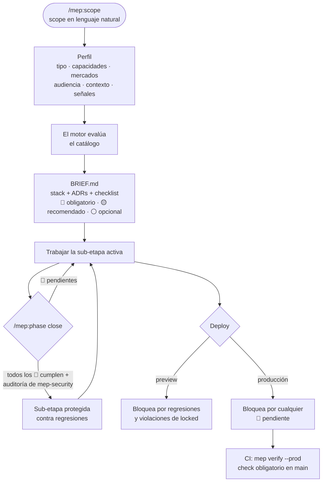

<div align="center">

# mise en place

**Scope → brief → checklist verificado, para websites y webapps hechos con Claude Code.**<br>
Tú describes el proyecto. mep sabe qué preguntar y qué exigir.

[](LICENSE)
[](.claude-plugin/plugin.json)
[](catalog/CHANGELOG.md)
[](https://docs.claude.com/en/docs/claude-code/plugins)
[](https://github.com/DietrichGebert/ponytail)
[](https://github.com/engelbertgm/Batuta)
[](CONTRIBUTING.md)

[English](README.md) · **Español**

</div>

---

La mayoría de los proyectos web salen sin etiqueta canonical, con una tabla sin RLS o con un secreto en el repo. Nadie lo pidió, así que nadie lo hizo. mep convierte un scope en lenguaje natural en un **perfil de proyecto**, filtra un catálogo condicional hasta lo que aplica, escribe un **brief** con stack justificado y checklist, y **bloquea** cerrar el trabajo o desplegar mientras falten obligatorios. Un motor determinista revisa el repo, no el modelo.

## Cómo funciona



| Nivel | Efecto |
| --- | --- |
| 🔴 obligatorio | Bloquea según la sub-etapa. Siempre bloquea el deploy a producción. Solo se desactiva con `/mep:override`, razón escrita y confirmación explícita |
| 🟡 recomendado | Alerta. Solo se omite con `/mep:skip` y razón escrita |
| ⚪ opcional | Informa. Se elige en `/mep:scope` |
| 🔒 locked | No se desactiva nunca: secretos, RLS, hashing de contraseñas, autorización por recurso, datos de tarjeta, HTTPS. Una violación detectada bloquea en cualquier momento |

Las sub-etapas van en orden: `foundation.setup → foundation.design → build.data → build.features → build.ux → launch.content → launch.seo → launch.ops`. Los obligatorios solo bloquean cuando su sub-etapa está cerrada, así que el trabajo inicial no se atora con checks de lanzamiento.

| Agente | Modelo | Esfuerzo | Rol |
| --- | --- | --- | --- |
| `mep-locator` | Haiku | bajo | Encuentra código y piezas reutilizables leyendo primero `CODEMAP.md` y `REGISTRY.md`. Solo lectura |
| `mep-security` | Opus | alto | Implementa y audita los ítems de seguridad. Sus reportes en `.mep/security/` son lo único que da por cumplido un ítem de seguridad |

> [!NOTE]
> Un ítem de seguridad cuenta como cumplido solo si sus verificaciones automáticas pasan **y** `mep-security` dejó un reporte vigente. El reporte guarda un hash de los archivos que revisó; si alguno cambia, el reporte vence y el ítem vuelve a estar pendiente.

## Funciona con

| Plugin | Cómo se complementan |
| --- | --- |
| [ponytail](https://github.com/DietrichGebert/ponytail) | Aplica el mantra de código en cada cambio. `/ponytail-review` reemplaza la revisión de calidad de mep al cerrar una sub-etapa, y sus hallazgos "must fix" bloquean el cierre |
| [batuta](https://github.com/engelbertgm/Batuta) | Envía cada tarea al modelo adecuado (Opus decide, Sonnet ejecuta, Haiku lee). Los dos agentes de mep son excepciones fijas: localizar código siempre va a `mep-locator` y seguridad siempre a `mep-security` |

Los dos son opcionales. mep funciona solo.

## Requisitos

- Claude Code (los mods necesitan la versión 2.1.287 o posterior; las anteriores usan los hooks incluidos)
- Node.js 20 o posterior
- Proyectos en un repositorio git
- Recomendado: el plugin [ponytail](https://github.com/DietrichGebert/ponytail). mep funciona sin él y usa su propia revisión de calidad

## Instalación

```
/plugin marketplace add engelbertgm/Mise-en-place
/plugin install mep@mise-en-place
```

Luego, en la carpeta de un proyecto nuevo o existente:

```
/mep:scope --preset saas "app de reservas para estudios de danza, México y California, planes mensuales"
```

> [!TIP]
> Pruébalo sin instalar: `claude --plugin-dir <ruta-a-este-repo>` y corre `/mep:scope` en una carpeta vacía.

## Uso

| Comando | Qué hace |
| --- | --- |
| `/mep:scope [--preset <nombre>] <descripción>` | Pregunta solo lo que cambia ítems 🔴 y escribe `.mep/profile.yaml`, `BRIEF.md`, los ADRs de stack, el bloque de `CLAUDE.md` y el workflow de CI |
| `/mep:add <cambio>` | Actualiza el scope y muestra **solo el diff**: ítems nuevos, ítems que suben de nivel e ítems que dejan de aplicar |
| `/mep:check` | Estado por sub-etapa: ✅ cumplido · ❌ pendiente · ⏭️ omitido · ⚠️ desactivado. Avisa si el código muestra señales que el perfil no tiene |
| `/mep:phase [close <sub-etapa>]` | Sub-etapa activa y qué falta; `close` corre la auditoría de seguridad y la revisión de calidad, y la cierra |
| `/mep:skip <id> <razón>` | Omite un ítem 🟡 |
| `/mep:override <id> <razón>` | Desactiva un ítem 🔴 tras confirmar; rechaza ítems 🔒 |
| `/mep:audit [scope]` | Para un repo existente: parte del scope del proyecto, lo contrasta con lo que muestra el código (lo que sobra y lo que falta) y reporta la brecha solo con las reglas que ese scope activa. No cambia nada hasta que adoptes el brief |
| `/mep:update` | Trae los ítems nuevos del catálogo que aplican a tu perfil. Los que caen en una sub-etapa cerrada tienen periodo de gracia |
| `/mep:quote [--client]` | Cotización desde el brief. Vista interna (horas, tarifa, márgenes) o vista cliente (precio y semanas estimadas por fase, extras, costos recurrentes, planes de mantenimiento) |
| `/mep:export [--lang es]` | Brief para el cliente en .docx y .pdf, en su idioma, con versión y cambios respecto a la anterior |
| `/mep:log-time <id> <horas>` | Registra horas reales por ítem fuera del repo; con datos suficientes, mep sugiere nuevos rangos |

Los umbrales de calidad de código (complejidad 10, 300 líneas por archivo, 50 por función) viven en el perfil; relajar uno pide razón: `mep threshold complexity 15 "<razón>" --yes`, marcado con ⚠️ en el brief.

La cotización corre sola solo al definir el scope (`/mep:scope`) y cuando cambia (`/mep:add`, que muestra el impacto en horas y precio antes de aceptar). Tarifas, horas reales y cotizaciones internas viven en `~/.config/mep-check/`, nunca en el repo.

Presets: `landing`, `corporate`, `ecommerce`, `saas`, `marketplace`.

Cada regla se activa por el scope del proyecto (tipo, capacidades, mercados, audiencia, contexto, señales), nunca por defecto: una landing sin cuentas no recibe reglas de RLS, un sitio sin cookies no recibe banner. `mep explain <id>` muestra la condición de la regla con ✓/✗ y por qué aplica o no.

<details>
<summary><b>Perfil del proyecto</b> (<code>.mep/profile.yaml</code>, la fuente de verdad)</summary>

```yaml
project: "estudio-de-danza"
phase:
  closed: [foundation.setup]
  active: foundation.design
type: saas
capabilities: [auth, payments, subscriptions, email]
markets: [MX, USA:CA]
audience: [b2c]
context: client-project
counts: { pages: 12, entities: 6, languages: 2, integrations: 3 }
signals:
  has_forms: true
  has_db: true
  db_client_access: true
  has_dates: true
selections:
  optional_added: []
  recommended_skipped:
    - { id: csp-strict, reason: "MVP; se agrega post-lanzamiento", date: 2026-10-12 }
  overrides: []
stack:
  decided: { framework: nextjs, hosting: vercel, db: postgresql }
```

Solo se aceptan valores de [`catalog/dimensions.yaml`](catalog/dimensions.yaml). Las capacidades encienden señales por sí solas (`auth` → formularios, base de datos, datos personales); más de un idioma activa `i18n`.

</details>

<details>
<summary><b>Ítem del catálogo</b> (una entrada de <code>catalog/items/*.yaml</code>)</summary>

```yaml
- id: rls-all-tables
  title: RLS activo en todas las tablas
  category: security
  level: required
  phase: build.data
  locked: true
  since: "2026.10.1"
  effort: { size: M, hours: [2, 6], scales_with: entities }
  when: { signals: { has_db: true, db_client_access: true } }
  why: "Con acceso directo desde el cliente (Supabase), una tabla sin RLS es pública para cualquiera con la anon key."
  how: "Cada create table en migraciones va con su enable row level security."
  verify:
    - { type: sql, rule: rls_enabled }
```

Tipos de verificación: `file_exists`, `route_exists` (Next.js, Astro, Vite/React, estático), `grep` (presente o ausente), `json_key`, `command`, `html` (reglas sobre la salida del build: títulos únicos, un `h1`, orden de headings, meta tags…), `sql` (RLS en migraciones) y `manual`. Todas las corre el motor, nunca el modelo.

</details>

<details>
<summary><b>Cuándo bloquea</b></summary>

| Momento | Bloquea por |
| --- | --- |
| Terminar un turno (Stop) | 🔴 de sub-etapas **cerradas** (regresiones) y violaciones 🔒. Los 🔴 pendientes de la sub-etapa activa se muestran como información |
| Deploy de preview (`vercel`, `netlify deploy`) | Lo mismo que Stop |
| Deploy a producción (`vercel --prod`, push a `main`) | Cualquier 🔴 pendiente, en todas las sub-etapas |
| Abrir o fusionar un PR a `main` | Una vez por commit: primero una revisión de calidad (`/ponytail-review branch`, o la revisión propia de mep) |
| Pull request a `main` | `mep verify --prod` en CI. Es la barrera real: el deploy a producción suele correr al hacer merge, donde los hooks de Claude Code no corren |
| Escribir un archivo | Se rechaza escribir un secreto en un archivo versionado |

Nada corre en un repo sin `.mep/profile.yaml`. Escape de emergencia: `MEP_BYPASS=1` (nunca para ítems 🔒; queda registrado en `.mep/log`).

</details>

<details>
<summary><b>Qué vive dónde</b></summary>

| Dentro del repo (versionado) | Fuera del repo (`~/.config/mep-check/`) |
| --- | --- |
| `.mep/profile.yaml`, `.mep/log`, `.mep/security/`, `BRIEF.md`, `docs/decisions/` | Tarifas, horas reales, cotizaciones internas |

En un `client-project` el repo se entrega al cliente, así que nada interno de tu negocio se queda en él.

</details>

## Estructura de carpetas

### Este repositorio

```
Mise-en-place/
├── .claude-plugin/
│   ├── plugin.json            # manifiesto del plugin
│   └── marketplace.json       # hace el repo instalable con /plugin
├── skills/                    # cada carpeta es un comando /mep:<nombre>
│   ├── mep/                   # guía: interpretar un scope, usar el catálogo, respetar el brief
│   ├── scope/  add/  check/  phase/  skip/  override/
│   ├── audit/  update/
│   └── quote/  export/  log-time/
├── agents/
│   ├── mep-locator.md         # Haiku, solo lectura: encuentra código con los mapas
│   └── mep-security.md        # Opus: implementa y audita los ítems de seguridad
├── hooks/
│   └── hooks.json             # módulo de mods + hooks de respaldo (SessionStart, Stop, PreToolUse, PostToolUse)
├── mods/
│   ├── register.ts            # gate, comandos instantáneos y línea de estado, dentro de Claude Code
│   └── register.test.ts       # tests de los mods (claude plugin test .)
├── engine/
│   ├── src/                   # motor determinista en TypeScript, sin LLM
│   │   ├── evaluate.ts        # perfil + catálogo → ítems que aplican, diff, stack
│   │   ├── verify.ts          # corre las verificaciones de cada ítem (html.ts, sql.ts, maps.ts)
│   │   ├── gate.ts            # reglas de bloqueo y cierre de fases
│   │   ├── render.ts          # BRIEF.md, ADRs, bloque de CLAUDE.md
│   │   ├── audit.ts           # infiere el perfil de un repo existente
│   │   ├── update.ts          # ítems nuevos del catálogo, periodo de gracia
│   │   ├── quote.ts           # cotización, horas reales, calibración
│   │   ├── export.ts docs.ts  # brief para el cliente → .docx y .pdf
│   │   └── cli.ts             # el comando `mep` que llaman skills, mods, hooks y CI
│   └── dist/mep.mjs           # bundle sin dependencias en ejecución (versionado)
├── catalog/
│   ├── dimensions.yaml        # valores válidos: tipos, capacidades, mercados, señales, fases
│   ├── items/                 # un archivo por categoría (base, seo, security, ux, legal…)
│   ├── markets/               # un archivo por mercado (mx, usa, ca, eu, uk, br, in)
│   ├── presets/               # landing, corporate, ecommerce, saas, marketplace
│   ├── stack-rules.yaml       # recomendaciones de stack con su porqué
│   ├── signals.yaml detect.yaml  # lo que revela el código (señales, capacidades)
│   ├── costs.yaml codemap.yaml sensitive.yaml
│   ├── VERSION
│   └── CHANGELOG.md
├── templates/
│   ├── claude-md.md           # bloque que se agrega al CLAUDE.md del proyecto
│   ├── ci/mep.yml             # workflow de CI que se instala en cada proyecto
│   ├── tests/responsive.spec.ts  # test responsive de Playwright que se instala en cada proyecto
│   └── client-brief/          # plantilla del brief para el cliente (es, en)
├── examples/estudio-saas/     # proyecto de prueba que usa tests/e2e.spec.ts
├── tests/                     # tests del motor, la CLI y de punta a punta (node:test)
└── docs/spec.md               # especificación completa
```

### Lo que mep agrega a tu proyecto

```
tu-proyecto/
├── .mep/
│   ├── profile.yaml           # fuente de verdad: tipo, capacidades, mercados, señales, fase
│   ├── log                    # overrides, bypass y cambios de fase
│   ├── security/<id>.json     # reportes de auditoría de mep-security
│   └── exports.yaml           # versiones del brief para el cliente
├── BRIEF.md                   # brief generado: perfil, stack, checklist por sub-etapa
├── CLAUDE.md                  # + el bloque de mep (se conserva lo que había)
├── CODEMAP.md                 # dónde está qué
├── REGISTRY.md                # piezas reutilizables
├── docs/
│   ├── decisions/             # ADRs, empezando por las decisiones de stack
│   └── client/brief-vN.*      # brief para el cliente (.md, .docx, .pdf)
├── tests/responsive.spec.ts   # 360–2560 px, sin scroll horizontal ni elementos encimados (Playwright)
└── .github/workflows/mep.yml  # mep verify --prod como check obligatorio

~/.config/mep-check/           # fuera del repo: nunca se entrega al cliente
├── rates.yaml                 # tus tarifas
├── quotes/<proyecto>/         # cotizaciones internas
└── actuals/<proyecto>.yaml    # horas reales para calibrar
```

## Por dentro

- **Motor** ([`engine/src`](engine/src)): TypeScript, sin LLM. Mismo perfil, mismos ítems, mismo resultado. Se empaqueta en [`engine/dist/mep.mjs`](engine/dist/mep.mjs) sin dependencias en tiempo de ejecución y se publica como `@engelbertgm/mep` para el CI.
- **Mods** ([`mods/register.ts`](mods/register.ts)): corren dentro de Claude Code. `/mep:check` y `/mep:phase` responden al instante, sin turno de Claude; los deploys esperan al gate del motor; la línea de estado muestra la sub-etapa activa y los 🔴/🟡 pendientes.
- **Hooks** ([`hooks/hooks.json`](hooks/hooks.json)): SessionStart, Stop, PreToolUse y PostToolUse, como respaldo donde no hay mods.
- **CI** ([`templates/ci/mep.yml`](templates/ci/mep.yml)): lo instala `/mep:scope`. Corre gitleaks, `pnpm audit`, el build y `mep verify --prod`.
- **Mapas**: `mep codemap` y `mep registry` generan `CODEMAP.md` y `REGISTRY.md` desde el código. "Para qué" y "No usar para" se escriben en el comentario de cada export; un export sin entrada bloquea cuando su sub-etapa está cerrada.
- **Export**: un subconjunto simple de Markdown se convierte en .docx y .pdf sin dependencias, así funciona en cualquier máquina.
- **Catálogo** ([`catalog/`](catalog)): 345 ítems de accesibilidad, sistema de diseño, UX, contenido, formularios, datos, responsive, seguridad, privacidad, legal, performance, i18n, calidad de código, despliegue y los mercados MX, USA, CA, EU, UK, BR e IN, cada ítem legal con su fuente oficial.

### Proyecto de prueba

[`examples/estudio-saas`](examples/estudio-saas) es un SaaS ficticio (auth y pagos, MX + USA:CA + EU:DE). [`tests/e2e.spec.ts`](tests/e2e.spec.ts) recorre todo el flujo sobre él: audit, scope, cierre de una sub-etapa con la auditoría de seguridad, regresiones, un secreto en el código, el gate de producción, un cambio de scope con su impacto en la cotización, el export para el cliente y una actualización del catálogo.

## Limitaciones

> [!WARNING]
> mep es un checklist guiado, no asesoría legal. Los ítems legales citan fuentes oficiales, pero un abogado debe revisarlos para tu mercado.

- El check de CI solo bloquea merges cuando lo marcas como **obligatorio** en la protección de ramas del repo.
- Las verificaciones de HTML necesitan una salida de build (`out/`, `.next/server/app`, `dist/`). Sin ella, esos ítems quedan pendientes en lugar de pasar.
- Muchos ítems de UX, legal y diseño son `manual`: el motor los lleva, pero los confirma una persona (o `mep-security`, en seguridad).
- Los precios de `catalog/costs.yaml` y los rangos de esfuerzo son estimaciones; verifica precios actuales y calibra con `/mep:log-time`.

El diseño completo está en [docs/spec.md](docs/spec.md).

## Desarrollo

```
pnpm install
pnpm test                 # compila el motor y corre sus tests
pnpm typecheck
claude plugin test .      # tests de los mods
claude plugin validate .
```

Después de cambiar `engine/src`, corre `pnpm build` y versiona `engine/dist/mep.mjs`; el CI revisa que coincidan.

## Contribuir

Lee [CONTRIBUTING.md](CONTRIBUTING.md) y el [Código de Conducta](CODE_OF_CONDUCT.md). Reporta vulnerabilidades en privado como se describe en [SECURITY.md](SECURITY.md).

## Licencia

[Business Source License 1.1](LICENSE). Uso libre, incluso en proyectos pagados para clientes, para:

- personas (diseñadores y desarrolladores independientes),
- equipos de hasta 5 personas,
- uso no comercial, educativo y sin fines de lucro.

Las organizaciones más grandes necesitan una licencia comercial; [contacta al autor](https://github.com/engelbertgm). Nadie puede revender mep ni ofrecerlo como producto o servicio pagado que compita con él. Cada versión pasa a [Apache-2.0](https://www.apache.org/licenses/LICENSE-2.0) cuatro años después de publicarse.
