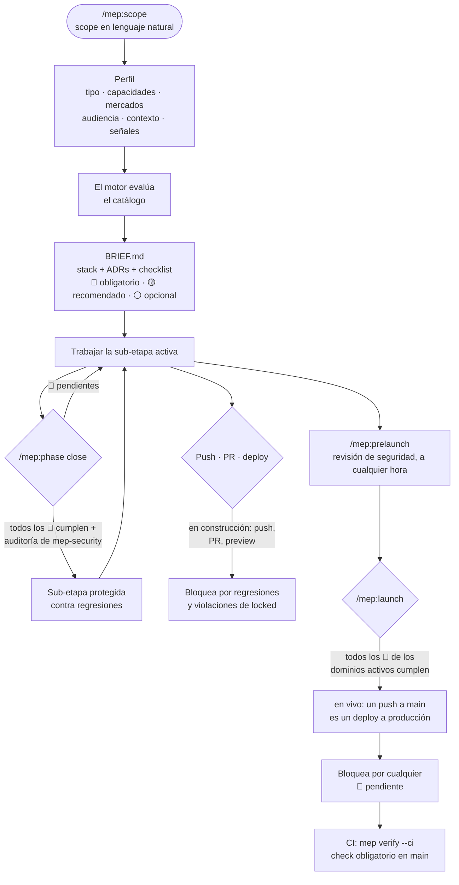

<div align="center">

# mise en place

**Scope → brief → checklist verificado, para websites y webapps hechos con Claude Code.**<br>
Tú describes el proyecto. mep sabe qué preguntar y qué exigir.

[](LICENSE)
[](.claude-plugin/plugin.json)
[](catalog/CHANGELOG.md)
[](https://docs.claude.com/en/docs/claude-code/plugins)
[](https://github.com/DietrichGebert/ponytail)
[](https://github.com/engelbertgm/Baladero)
[](CONTRIBUTING.md)

[English](README.md) · **Español**

</div>

---

La mayoría de los proyectos web salen sin etiqueta canonical, con una tabla sin RLS o con un secreto en el repo. Nadie lo pidió, así que nadie lo hizo. mep convierte un scope en lenguaje natural en un **perfil de proyecto**, filtra un catálogo condicional hasta lo que aplica, escribe un **brief** con stack justificado y checklist, y **bloquea** cerrar el trabajo o desplegar mientras falten obligatorios. Un motor determinista revisa el repo, no el modelo.

## Cómo funciona



**Las reglas son guías para construir, no tareas por cumplir.** Mientras construyes, el agente tiene presente `BRIEF.md` como cuando dices "haz el sitio, considerando accesibilidad y WCAG": escribe lo real bien a la primera. Los pendientes durante la construcción son normales; mep le indica al agente que nunca cree páginas de prueba, sitios placeholder ni código de relleno solo para que pase una verificación, ni recorra el checklist ítem por ítem. Las verificaciones corren en los puntos de control (cerrar una sub-etapa, `/mep:prelaunch`, `/mep:launch`, el CI), sobre lo que de verdad existe.

Nunca hace falta cerrar una sub-etapa para subir un push. Un proyecto empieza **en construcción**: un push o PR a `main` solo se detiene por secretos, violaciones 🔒 y regresiones en sub-etapas que ya cerraste. `/mep:launch` corre la barrera completa una vez; si pasa, el proyecto queda **en vivo** y cada push a `main` es un deploy a producción.

| Nivel | Efecto |
| --- | --- |
| 🔴 obligatorio | Bloquea una sub-etapa solo si la cierras. Bloquea el go-live y, ya en vivo, cada deploy. Se puede posponer con `/mep:defer` (el go-live lo sigue exigiendo) o desactivar con `/mep:override`, razón escrita y confirmación explícita |
| 🟡 recomendado | Alerta. Solo se omite con `/mep:skip` y razón escrita |
| ⚪ opcional | Informa. Se elige en `/mep:scope` |
| 🔒 locked | No se desactiva nunca: secretos, RLS, hashing de contraseñas, autorización por recurso, datos de tarjeta, HTTPS. Una violación detectada bloquea en cualquier momento |

Las sub-etapas van en orden: `foundation.setup → foundation.design → build.data → build.features → build.ux → launch.content → launch.seo → launch.ops`. Son un orden sugerido, no una compuerta: cerrar una es opcional y solo protege lo que hiciste contra regresiones, así que el trabajo inicial nunca se atora con checks de lanzamiento.

| Agente | Modelo | Esfuerzo | Rol |
| --- | --- | --- | --- |
| `mep-locator` | Haiku | bajo | Encuentra código y piezas reutilizables leyendo primero `CODEMAP.md` y `REGISTRY.md`. Solo lectura |
| `mep-security` | Opus | alto | Implementa y audita los ítems de seguridad. Sus reportes en `.mep/security/` son lo único que da por cumplido un ítem de seguridad |

> [!NOTE]
> Un ítem de seguridad cuenta como cumplido solo si sus verificaciones automáticas pasan **y** `mep-security` dejó un reporte vigente. El reporte guarda un hash de los archivos que revisó, siempre incluidos los archivos sensibles del grupo del ítem (auth, pagos, base de datos, configuración); si alguno cambia, el reporte vence y el ítem vuelve a estar pendiente.

### Lo que el agente no puede hacer

Los bloqueos de mep aguantan también los atajos del propio agente, no solo errores honestos:

- **El estado cambia solo con la CLI.** `.mep/profile.yaml`, el log, los reportes y las revisiones quedan sellados con un hash después de cada escritura. Una edición por fuera de la CLI bloquea `mep verify` (local y en CI, incluso con `MEP_BYPASS`) hasta que corras `/mep:resync`.
- **Tus acciones son tuyas.** `/mep:confirm`, `/mep:override`, `/mep:defer`, `/mep:domain off`, `/mep:threshold` (al relajar), `/mep:resync` y volver a construcción (`mep stage building`) solo corren cuando tú los escribes o los pulsas en el panel; desde el Bash del agente se niegan. Las confirmaciones registran tu usuario de git.
- **Los PR necesitan una revisión real.** La revisión de la rama se registra (`mep review record --pr`) y queda ligada al código; reintentar sin ella no pasa, y el CI también la pide.
- **Nada es silencioso.** El CI escribe en el resumen del job cada cambio de estado del PR (overrides, confirmaciones, cierres de fase, bypass, re-sellados), así lo ves antes del merge.

En la misma máquina nada es a prueba de todo; un truco deliberado igual queda a la vista en ese resumen.

### Documentos de planeación

mep mantiene un plan escrito en `docs/plan/`, así cada sesión construye contra el mismo plan y no contra lo que recuerda:

| Documento | Qué responde | Se escribe |
| --- | --- | --- |
| `PRD.md` | Qué se construye, para quién y cómo se mide el éxito | `/mep:scope` |
| `TRD.md` | Stack, arquitectura, entornos y requisitos no funcionales | `/mep:scope` |
| `IMPLEMENTATION.md` | Fases, hitos y calendario | `/mep:scope` |
| `FLOWS.md` | Cada pantalla y cada recorrido principal del usuario | al empezar `foundation.design` |
| `SCHEMA.md` | Tablas, relaciones, autenticación y seguridad por fila | al empezar `build.data` (solo con base de datos) |

Cada uno tiene secciones fijas y diagramas hechos con [diagram-design](https://github.com/cathrynlavery/diagram-design). El motor comprueba que existan y que coincidan con el código: una ruta de página que falta en `FLOWS.md`, o una tabla de las migraciones que falta en `SCHEMA.md`, regresa el ítem a pendiente. En proyectos para clientes, `/mep:export` genera además versiones sin jerga del PRD, los flujos y la implementación, con los diagramas aptos para el cliente. Cualquiera se convierte a .docx y .pdf con `mep export --in docs/plan/<DOC>.md`.

No tienen un comando propio: `/mep:scope` escribe los tres primeros, la skill `mep` escribe FLOWS y SCHEMA al empezar su sub-etapa, `/mep:add` los actualiza cuando cambia el scope, `/mep:update` escribe los que falten en proyectos ya avanzados, y los ítems `plan-*` del checklist dicen cuáles faltan o están desactualizados.

### A la medida del scope, no del tipo

El catálogo es una **guía general**, no una lista por tipo de proyecto. En `/mep:scope`, Claude arma el perfil con hechos concretos, revisa lo que propone el catálogo y lo ajusta a *este* proyecto: conserva lo que aplica, descarta lo que no (con razón), adapta lo que aplica distinto (nota) y agrega lo que falta. Si tiene dudas, pregunta (pocas a la vez). Los 🔒 nunca se descartan.

- Lo descartado queda en `tailoring.not_applicable` (`id` + `reason`) y lo adaptado en `tailoring.notes` del perfil. Se ve como `off` ("no aplica a este scope"), no cuenta, y aparece en `BRIEF.md` (nota 🎯, "Ajustado a este scope") y en `SCOPE.md` ("A tu medida").
- `/mep:add` y `/mep:audit` vuelven a ajustar cuando cambia el scope.
- El panel y los nombres de dominio están en inglés.

### Dominios

Cada ítem vive en un **dominio** y un **subdominio** (`ui.motion`, `security.abuse`, `payments.checkout`, `quality.typescript`…): UI, UX, accesibilidad, frontend, idiomas, backend, cuentas y acceso, pagos, base de datos, seguridad, privacidad, legal, SEO, contenido, producto por tipo, analítica, infraestructura y calidad por lenguaje. [`catalog/domains.yaml`](catalog/domains.yaml) es la única fuente del hogar de cada ítem y guarda los **enlaces**: un ítem puede aparecer en otros subdominios como sugerencia (↗), mientras su estado y su nivel siguen donde vive.

- `/mep:domains` muestra el avance por dominio con una barra de braille; `/mep:focus <dominio[.subdominio]>` lista lo pendiente ahí, con los ítems enlazados.
- Trabaja por área si lo prefieres: el panel agrupa por sub-etapa o por dominio.
- Un dominio o subdominio se apaga entero (`/mep:domain off backend.queues "lo lleva otro equipo"`): sus ítems dejan de contar, los 🔒 siguen activos, y queda marcado ⚠️ en `BRIEF.md` y en el resumen del PR.
- Lo que no aplica al scope ya queda fuera por la condición del propio ítem. Los lenguajes siguen lo que usa el código: `has_typescript`, `has_css`, `has_sql`, `has_python`, `has_react`… encienden o apagan sus reglas de calidad.

### Revisión de seguridad antes de salir

`/mep:prelaunch` es tu propia lista de seguridad, línea por línea y en palabras simples. Cada línea se arma con ítems del catálogo, y una línea cuyos ítems no aplican al scope sale como "no aplica" (sin subidas, sin admin, sin cobros…). No cambia nada y se corre a cualquier hora, para arreglar con calma; `/mep:launch` pide esos mismos ítems junto con todo lo demás.

| # | Línea | Ítems que la forman |
| --- | --- | --- |
| 1 | Contraseñas guardadas con hash (argon2 o bcrypt) | `password-hashing` 🔒 |
| 2 | Llaves de API solo en el servidor, nunca en el navegador | `server-only-keys`, `public-env-prefix` |
| 3 | La base de datos solo deja ver a cada quien lo suyo | `rls-all-tables`, `rls-policies-per-operation`, `resource-authorization`, `db-least-privilege` |
| 4 | HTTPS forzado en todos lados | `https-hsts` |
| 5 | Cada formulario se revisa en el servidor, no solo en la página | `form-server-validation` |
| 6 | XSS bloqueado y consultas seguras: nadie cuela SQL | `no-raw-html`, `csp-strict`, `no-sql-injection` |
| 7 | Límite de intentos en el login y en los envíos | `auth-rate-limit`, `form-rate-limit` |
| 8 | Protección CSRF | `csrf-protection` |
| 9 | Cookies de sesión seguras | `secure-session-cookies` |
| 10 | Los enlaces de recuperación de contraseña expiran (≤ 1 hora, un solo uso) | `password-reset-expiry`, `password-recovery` |
| 11 | Subidas controladas: solo los formatos permitidos, con tope de tamaño, contenido revisado y servidas sin riesgo | `upload-validation`, `upload-type-allowlist`, `upload-size-limits`, `upload-content-hardening`, `upload-antivirus`, `upload-served-safely` |
| 12 | Las páginas de admin, bajo llave | `admin-roles`, `admin-mfa` |
| 13 | Cada precio se vuelve a revisar en el servidor | `server-side-prices` 🔒 |
| 14 | Modo debug apagado: el detalle va a logs privados y el usuario solo ve un mensaje | `production-errors-hidden`, `debug-mode-off` |
| 15 | Paquetes riesgosos actualizados y los que no usas, eliminados | `no-critical-vulnerabilities`, `dependency-scan-ci`, `unused-dependencies` |
| 16 | Historial de git revisado en busca de llaves filtradas; las que aparezcan, reemplazadas | `secrets-scan-ci`, `secrets-history-clean`, `key-rotation-procedure` |

Cada línea muestra ✅ lista · ❌ falta algo (y qué) · ❔ falta correr comandos o el build (`--full`) · ⊘ no aplica. Los ítems de seguridad solo cuentan con un reporte vigente de `mep-security`. `--full` corre `gitleaks` y `knip`, que deben estar instalados en tu máquina.

Las líneas viven en [`catalog/prelaunch.yaml`](catalog/prelaunch.yaml). Las revisiones de subidas van más allá del tipo: lista corta de formatos por uso (la extensión, el tipo real y el Content-Type declarado deben coincidir), imágenes re-codificadas, SVG y PDF sin código activo, comprimidos con tope, y archivos servidos desde otro origen con `nosniff`.

### El panel

`/mep:panel` abre un panel junto al chat (también se abre solo cuando un proyecto tiene mep). Cada línea es `NOMBRE … barra de braille  rojos amarillos blancos`: la barra se llena conforme pasan los obligatorios y va de rojo a verde, y los tres números son los 🔴, 🟡 y ⚪ elegidos pendientes, cada uno en su color. Dentro de una categoría, los ítems van bajo un encabezado por nivel (`Required (12)` en rojo, `Recommended (4)` en amarillo), cada uno con su círculo: ● rojo obligatorio, ● amarillo recomendado, ○ blanco opcional. El encabezado nombra el nivel, así que se lee aunque una superficie no muestre color.

- **Por sub-etapa o por dominio:** un selector cambia la agrupación; en la vista por dominio, los ítems enlazados desde otros dominios salen con ↗.
- **La etapa a la vista:** si un push es solo integrar (en construcción) o un deploy a producción (en vivo).
- **Un ítem:** por qué, cómo, qué falta (los primeros seis hallazgos, el resto tras "más") y tus acciones: confirmar, omitir, posponer hasta el go-live o desactivar con un diálogo.
- **⇢ Flujo:** qué comando correr y cuándo, como una línea de pasos (definir el scope → trabajar → decisiones que solo tú tomas → subir avance → antes de salir → salir en vivo → después). Lista todos los comandos `/mep:`, marca dónde estás (✓ hecho, ▶ aquí, ○ falta) y un clic escribe el comando en el chat con sus argumentos por completar; tú le das Enter. Donde la superficie dibuja su propio chat (VS Code), lo copia al portapapeles.
- **⚙ Herramientas:** comandos instantáneos, los que toman un turno de Claude, campos de texto para `/mep:scope`, `/mep:add` y `/mep:log-time`, y las preguntas "¿puedo deployar a producción?" y "¿puedo abrir PR a main?".
- **Un spinner de braille** gira mientras el motor trabaja. Los colores van fuera de los botones y, fuera de la terminal, son fijos, porque algunas superficies repintan la etiqueta de un botón.

### Guías y controles de calidad

[`catalog/guidelines.md`](catalog/guidelines.md) reúne los principios de diseño, UX, copy y código con los que trabaja mep: Nielsen, Norman, Shneiderman, las leyes de UX, Maeda y Rams, Cialdini y posicionamiento, KISS, YAGNI, DRY, SOLID, Gall, Conway y Twelve-Factor. Claude lee solo la sección de la sub-etapa activa (diseño visual en `foundation.design`, interacción y usabilidad en `build.ux`, copy y conversión en `launch.content` para landing, ecommerce, marketplace y SaaS), y la revisión de cierre revisa las pantallas clave contra ella.

Lo que se puede medir es una verificación, no un principio:

| Área | Verificaciones |
| --- | --- |
| Interfaz | objetivos táctiles ≥ 44×44 px y un solo CTA principal por vista (test responsive), contraste, foco, escala de espaciado, 2 familias tipográficas, 45–75 caracteres por línea, todos los estados asíncronos, sin patrones oscuros |
| Código (JS/TS) | complejidad ≤ 10, archivos ≤ 300 líneas, funciones ≤ 50 líneas, ≤ 4 parámetros, sin imports circulares, tipos estrictos, sin código duplicado ni muerto (jscpd y knip se ejecutan de verdad) |
| Código (TypeScript) | sin `@ts-ignore`, lint con tipos (sin promesas flotantes), `noUncheckedIndexedAccess`, datos externos validados con un esquema |
| Código (Python) | Ruff con los mismos límites y sus reglas de seguridad, mypy --strict, pytest, lockfile con pip-audit, vulture; solo en proyectos con `pyproject.toml`, `requirements*.txt` o `uv.lock` |
| CSS · HTML · SQL | Stylelint, sin `!important`, peso del CSS; HTML válido y semántico sin manejadores inline; lint de SQL, migraciones seguras, claves foráneas con índice |
| Frameworks · CI | lint de hooks de React y de jsx-a11y, `"use client"` solo donde hace falta; actionlint, shellcheck, hadolint, `.editorconfig` con finales de línea LF |
| Arquitectura | Twelve-Factor (config validada desde env, servidor sin estado, logs a stdout, runtime fijado) y, si lo quieres, lo que ya existe desplegado a preview desde el principio (ley de Gall; opcional, nunca una página de relleno) |
| Diseño de sistemas | llaves de idempotencia, caché y CDN, colas de mensajes, rate limit con almacén compartido y 429, circuit breakers y timeouts, logs estructurados, métricas y trazas; con `high_traffic` también balanceo de carga, réplicas y recuperación, un modelo de consistencia (CAP), sharding y hashing consistente |
| Honestidad y privacidad | sin reseñas falsas, afirmaciones con respaldo, un aviso junto a cada formulario, minimización de datos, auditoría de SDKs de terceros, identidad del negocio en la página |

Los lenguajes no están fijos en el código: cada grupo se enciende con una señal que el código revela (`has_typescript`, `has_css`, `has_html`, `has_sql`, `has_python`, `has_react`, `has_tailwind`, `has_ci`, `has_shell`, `has_docker`). PHP, Ruby, Go y Rust se pueden agregar con la misma plantilla de Python cuando alguien los use.

## Funciona con

| Plugin | Cómo se complementan |
| --- | --- |
| [ponytail](https://github.com/DietrichGebert/ponytail) | Aplica el mantra de código en cada cambio. `/ponytail-review` reemplaza la revisión de calidad de mep al cerrar una sub-etapa. El motor detecta Ponytail y exige la revisión registrada (`mep review record`), sin "must fix" y sobre el código actual, antes de cerrar |
| [diagram-design](https://github.com/cathrynlavery/diagram-design) | Dibuja los diagramas de los documentos de planeación (recorrido, arquitectura, flujos, secuencia, esquema de datos, Gantt). Requerido para escribirlos; su exportación a PNG necesita Python y Playwright |
| [baladero](https://github.com/engelbertgm/Baladero) | HUD en vivo para Claude Code: modelo, git, barras de contexto y uso, herramientas, pendientes y el costo de cada tarea. La línea de estado y el panel de mep muestran el checklist; Baladero muestra lo que la sesión gasta en cumplirlo |

ponytail y baladero son opcionales. diagram-design es requerido para los documentos de planeación.

## Requisitos

- Claude Code (los mods necesitan la versión 2.1.287 o posterior; las anteriores usan los hooks incluidos)
- Node.js 20 o posterior
- Proyectos en un repositorio git
- El plugin [diagram-design](https://github.com/cathrynlavery/diagram-design) (2.6.136 o posterior), con Python y Playwright para exportar a PNG, para escribir los documentos de planeación
- Recomendado: el plugin [ponytail](https://github.com/DietrichGebert/ponytail). mep funciona sin él y usa su propia revisión de calidad
- Opcional, para `mep prelaunch --full`: `gitleaks` y `knip` instalados en tu máquina

## Instalación

```
/plugin marketplace add engelbertgm/Mise-en-place
/plugin install mep@mise-en-place
```

Luego, en la carpeta de un proyecto nuevo o existente:

```
/mep:scope --preset saas "app de reservas para estudios de danza, México y California, planes mensuales"
```

Las instrucciones del plugin para el modelo (skills, agentes y el bloque de `CLAUDE.md` que mep agrega a un proyecto) están en inglés porque cuesta menos tokens; el asistente te sigue hablando en tu idioma, y el panel, los mensajes del motor y el catálogo están en español.

Para actualizar después: `claude plugin marketplace update mise-en-place`, luego `claude plugin update mep@mise-en-place`, y reinicia Claude Code (`/exit` y `claude --continue`). `claude plugin list` muestra la versión.

> [!TIP]
> Pruébalo sin instalar: `claude --plugin-dir <ruta-a-este-repo>` y corre `/mep:scope` en una carpeta vacía.

## Uso

| Comando | Qué hace |
| --- | --- |
| `/mep:scope [--preset <nombre>] <descripción>` | Pregunta solo lo que cambia ítems 🔴 y escribe `.mep/profile.yaml`, `SCOPE.md` (el scope en palabras simples: qué incluye y qué no), `BRIEF.md`, los ADRs de stack, el bloque de `CLAUDE.md`, el workflow de CI, y el PRD, el TRD y el plan de implementación con sus diagramas |
| `/mep:add <cambio>` | Actualiza el scope y muestra **solo el diff**: ítems nuevos, ítems que suben de nivel e ítems que dejan de aplicar. Actualiza los documentos de planeación afectados |
| `/mep:check` | Estado por sub-etapa: ✅ cumplido · ❌ pendiente · ⏭️ omitido · ⚠️ desactivado. Avisa si el código muestra señales que el perfil no tiene |
| `/mep:phase [close <sub-etapa>]` | Sub-etapa activa y qué falta; `close` (opcional) corre la auditoría de seguridad y la revisión de calidad, y la cierra |
| `/mep:domains [dominio]` · `/mep:focus <ruta>` | Avance por dominio y subdominio; lo pendiente en uno, con los ítems enlazados desde otros dominios (↗) |
| `/mep:prelaunch [--full]` | Revisión de seguridad antes de salir, línea por línea (hash de contraseñas, llaves en el servidor, acceso a la base de datos, HTTPS, XSS/SQL, límites de intentos, CSRF, cookies, subidas, admin, precios, debug, paquetes, historial de git). No cambia nada; córrela a cualquier hora |
| `/mep:launch` | Go-live: corre la barrera completa una vez. Si pasa, el proyecto queda en vivo y un push a `main` es un deploy a producción |
| `/mep:defer <id> <razón>` · `/mep:domain off <ruta> <razón>` | Acciones tuyas: posponer un 🔴 hasta el go-live (`defer undo <id>` lo devuelve); apagar un dominio entero |
| `/mep:skip <id> <razón>` | Omite un ítem 🟡 |
| `/mep:override <id> <razón>` | Desactiva un ítem 🔴; rechaza ítems 🔒. Solo lo escribes tú: el agente no puede |
| `/mep:panel` | Panel junto al chat: pendientes por sub-etapa o por dominio, y un botón **Flujo** (qué comando correr y cuándo; un clic lo escribe en el chat); un clic en uno muestra qué pide, por qué y todo lo que falla, y permite confirmarlo, omitirlo o desactivarlo |
| `/mep:confirm <id>` · `/mep:threshold …` · `/mep:resync` | Acciones tuyas, nunca del agente: confirmar un ítem manual (con tu usuario de git), relajar un umbral de calidad, re-sellar el estado cambiado fuera de la CLI |
| `/mep:audit [scope]` | Para un repo existente: parte del scope del proyecto, lo contrasta con lo que muestra el código (lo que sobra y lo que falta) y reporta la brecha solo con las reglas que ese scope activa. No cambia nada hasta que adoptes el brief |
| `/mep:update` | Trae los ítems nuevos del catálogo que aplican a tu perfil, marcados ＋ nuevo o ✎ modificado. Los que caen en una sub-etapa cerrada tienen periodo de gracia. Escribe los documentos de planeación que falten |
| `/mep:quote [--client]` | Cotización desde el brief. Vista interna (horas, tarifa, márgenes) o vista cliente (precio y semanas estimadas por fase, extras, costos recurrentes, planes de mantenimiento) |
| `/mep:export [--lang es]` | Brief para el cliente en .docx y .pdf, en su idioma, con versión y cambios respecto a la anterior; en proyectos para clientes, también el PRD, los flujos y el plan de implementación con sus diagramas |
| `/mep:log-time <id> <horas>` | Registra horas reales por ítem fuera del repo; con datos suficientes, mep sugiere nuevos rangos |

Los umbrales de calidad de código (complejidad 10, 300 líneas por archivo, 50 por función, 4 parámetros) viven en el perfil y aplican igual a JS/TS y a Python; relajar uno pide razón: `mep threshold complexity 15 "<razón>" --yes`, marcado con ⚠️ en el brief.

La cotización corre sola solo al definir el scope (`/mep:scope`) y cuando cambia (`/mep:add`, que muestra el impacto en horas y precio antes de aceptar). Tarifas, horas reales y cotizaciones internas viven en `~/.config/mep-check/`, nunca en el repo.

Presets: `landing`, `corporate`, `ecommerce`, `saas`, `marketplace`.

Las verificaciones corren sobre el código, sobre la salida del build y, cuando el perfil tiene `urls.preview`/`urls.production` (o está `MEP_URL`), sobre el sitio desplegado y su DNS: los encabezados que de verdad envía, cookies, compresión y caché, un 404 real, redirecciones al dominio canónico, el sitemap y SPF/DMARC/DKIM.

Fuera del alcance a propósito: proyectos para menores de edad o que requieren verificar edad (contenido para adultos, apuestas, alcohol…). `/mep:scope` se detiene y un perfil con esa audiencia es inválido.

Cada regla se activa por el scope del proyecto (tipo, capacidades, mercados, audiencia, contexto, señales), nunca por defecto: una landing sin cuentas no recibe reglas de RLS, un sitio sin cookies no recibe banner. `mep explain <id>` muestra la condición de la regla con ✓/✗ y por qué aplica o no.

<details>
<summary><b>Perfil del proyecto</b> (<code>.mep/profile.yaml</code>, la fuente de verdad)</summary>

```yaml
project: "estudio-de-danza"
phase:
  closed: [foundation.setup]
  active: foundation.design
type: saas
capabilities: [auth, payments, subscriptions, email]
markets: [MX, USA:CA]
audience: [b2c]
context: client-project
counts: { pages: 12, entities: 6, languages: 2, integrations: 3 }
signals:
  has_forms: true
  has_db: true
  db_client_access: true
  has_dates: true
  has_typescript: true    # también has_javascript, has_css, has_html (por defecto true), has_sql, has_react…
  high_traffic: false     # solo el scope lo puede decir: enciende las reglas de escala
tailoring:               # ajuste del catálogo a este scope, hecho por Claude
  not_applicable:
    - { id: saas-trial-flow, reason: "sin prueba gratis; de pago desde el día uno" }
  notes:
    pricing-page: "solo dos planes; sin nivel enterprise"
selections:
  optional_added: []
  recommended_skipped:
    - { id: csp-strict, reason: "MVP; se agrega post-lanzamiento", date: 2026-10-12 }
  overrides: []
  domains_off: []         # { path: backend.queues, reason, date }: dominios apagados enteros
  deferred: []            # { id, reason, date }: 🔴 pospuestos hasta el go-live
stage: building           # building | live (mep launch)
stack:
  decided: { framework: nextjs, hosting: vercel, db: postgresql }
```

Solo se aceptan valores de [`catalog/dimensions.yaml`](catalog/dimensions.yaml). Las capacidades encienden señales por sí solas (`auth` → formularios, base de datos, datos personales); más de un idioma activa `i18n`.

</details>

<details>
<summary><b>Ítem del catálogo</b> (una entrada de <code>catalog/items/*.yaml</code>)</summary>

```yaml
- id: rls-all-tables
  title: RLS activo en todas las tablas
  category: security
  level: required
  phase: build.data
  locked: true
  since: "2026.10.1"
  effort: { size: M, hours: [2, 6], scales_with: entities }
  when: { signals: { has_db: true, db_client_access: true } }
  why: "Con acceso directo desde el cliente (Supabase), una tabla sin RLS es pública para cualquiera con la anon key."
  how: "Cada create table en migraciones va con su enable row level security."
  verify:
    - { type: sql, rule: rls_enabled }
```

Tipos de verificación: `file_exists`, `route_exists` (Next.js, Astro, Vite/React, estático), `grep` (presente o ausente), `json_key`, `command`, `html` (reglas sobre la salida del build: títulos únicos, un `h1`, orden de headings, meta tags…), `sql` (RLS en migraciones), `maps`, `quality`, `design`, `build` (HTML renderizado en servidor, peso del bundle, source maps), `robots`, `live` y `dns` (el sitio desplegado), `plan` (documentos de planeación) y `manual`. Todas las corre el motor, nunca el modelo.

El ítem no lleva `domain`: su hogar (`database.access`…) y sus enlaces a otros subdominios están en [`catalog/domains.yaml`](catalog/domains.yaml), y el catálogo no carga si a un ítem le falta.

</details>

<details>
<summary><b>Cuándo bloquea</b></summary>

| Momento | Bloquea por |
| --- | --- |
| Terminar un turno (Stop) | 🔴 de sub-etapas **cerradas** (regresiones) y violaciones 🔒. Los 🔴 pendientes de la sub-etapa activa se muestran como información |
| Push a `main` **en construcción** | Igual que Stop: regresiones, 🔒 y secretos. Los 🔴 pendientes no bloquean |
| Deploy de preview (`vercel`, `netlify deploy`) | Lo mismo que Stop |
| Deploy explícito a producción (`vercel --prod`…), o cualquier push a `main` ya **en vivo** | Cualquier 🔴 pendiente, en todas las sub-etapas de los dominios activos (los pospuestos incluidos) |
| `/mep:launch` | La misma barrera completa; si pasa, el proyecto queda en vivo |
| Abrir o fusionar un PR a `main` | Una vez por commit: primero una revisión de calidad (`/ponytail-review branch`, o la revisión propia de mep) |
| Pull request a `main` | `mep verify --ci` en CI (en construcción: regresiones; en vivo: la barrera completa). Es la barrera real: el deploy a producción suele correr al hacer merge, donde los hooks de Claude Code no corren |
| Escribir un archivo | Se rechaza escribir un secreto en un archivo versionado |

Nada corre en un repo sin `.mep/profile.yaml`. Escape de emergencia: `MEP_BYPASS=1` (nunca para ítems 🔒; queda registrado en `.mep/log`).

</details>

<details>
<summary><b>Qué vive dónde</b></summary>

| Dentro del repo (versionado) | Fuera del repo (`~/.config/mep-check/`) |
| --- | --- |
| `.mep/profile.yaml`, `.mep/log`, `.mep/security/`, `SCOPE.md`, `BRIEF.md`, `docs/decisions/` | Tarifas, horas reales, cotizaciones internas |

En un `client-project` el repo se entrega al cliente, así que nada interno de tu negocio se queda en él.

</details>

## Estructura de carpetas

### Este repositorio

```
Mise-en-place/
├── .claude-plugin/
│   ├── plugin.json            # manifiesto del plugin
│   └── marketplace.json       # hace el repo instalable con /plugin
├── skills/                    # cada carpeta es un comando /mep:<nombre>
│   ├── mep/                   # guía: interpretar un scope, usar el catálogo, respetar el brief
│   ├── scope/  add/  check/  phase/  skip/  panel/
│   ├── domains/  focus/  prelaunch/  launch/       # avance por dominio, lo pendiente en uno, revisión de seguridad, go-live
│   ├── override/  confirm/  threshold/  resync/  defer/  domain/   # solo tuyas (disable-model-invocation)
│   ├── audit/  update/
│   └── quote/  export/  log-time/
├── agents/
│   ├── mep-locator.md         # Haiku, solo lectura: encuentra código con los mapas
│   └── mep-security.md        # Opus: implementa y audita los ítems de seguridad
├── hooks/
│   └── hooks.json             # módulo de mods + hooks de respaldo (SessionStart, Stop, PreToolUse, PostToolUse)
├── mods/
│   ├── register.tsx           # gate, guardia, panel (por sub-etapa o dominio, línea de flujo), comandos instantáneos, línea de estado
│   └── register.test.ts       # tests de los mods (claude plugin test .)
├── types/index.d.ts           # contrato del estado del mod (panel)
├── engine/
│   ├── src/                   # motor determinista en TypeScript, sin LLM
│   │   ├── evaluate.ts        # perfil + catálogo → ítems que aplican, diff, stack
│   │   ├── verify.ts          # corre las verificaciones de cada ítem (html.ts, sql.ts, maps.ts)
│   │   ├── gate.ts            # reglas de bloqueo y cierre de fases
│   │   ├── seal.ts guard.ts   # estado sellado tras cada escritura; lo que el agente no puede tocar
│   │   ├── human.ts           # acciones que solo toma la persona
│   │   ├── live.ts            # verificaciones contra el sitio desplegado y su DNS
│   │   ├── render.ts          # BRIEF.md, ADRs, bloque de CLAUDE.md
│   │   ├── scope.ts           # SCOPE.md: el scope en palabras simples
│   │   ├── domains.ts         # dominios, barras de braille, resúmenes por dominio, focus
│   │   ├── prelaunch.ts       # la revisión de seguridad antes de salir
│   │   ├── audit.ts           # infiere el perfil de un repo existente
│   │   ├── update.ts          # ítems nuevos del catálogo, periodo de gracia
│   │   ├── quote.ts           # cotización, horas reales, calibración
│   │   ├── plan.ts            # documentos de planeación: secciones, diagramas, desvíos contra rutas y migraciones
│   │   ├── quality.ts         # límites de calidad de código en ESLint/Biome y Ruff
│   │   ├── export.ts docs.ts  # documentos para el cliente → .docx y .pdf, con imágenes PNG
│   │   └── cli.ts             # el comando `mep` que llaman skills, mods, hooks y CI
│   └── dist/mep.mjs           # bundle sin dependencias en ejecución (versionado)
├── catalog/
│   ├── dimensions.yaml        # valores válidos: tipos, capacidades, mercados, señales, fases
│   ├── guidelines.md          # principios de diseño, UX, copy y código, leídos por sub-etapa
│   ├── domains.yaml           # dominios y subdominios: el hogar de cada ítem y sus enlaces a otros subdominios
│   ├── prelaunch.yaml         # las 16 líneas de la revisión de seguridad antes de salir
│   ├── items/                 # archivos de ítems por tema (base, seo, security, ux, legal, languages…)
│   ├── markets/               # un archivo por mercado (mx, usa, ca, eu, uk, br, in)
│   ├── presets/               # landing, corporate, ecommerce, saas, marketplace
│   ├── stack-rules.yaml       # recomendaciones de stack con su porqué
│   ├── signals.yaml detect.yaml  # lo que revela el código (señales, capacidades)
│   ├── costs.yaml codemap.yaml sensitive.yaml
│   ├── VERSION
│   └── CHANGELOG.md
├── templates/
│   ├── claude-md.md           # bloque que se agrega al CLAUDE.md del proyecto
│   ├── ci/mep.yml             # workflow de CI que se instala en cada proyecto
│   ├── tests/responsive.spec.ts  # test responsive de Playwright que se instala en cada proyecto
│   ├── client-brief/          # plantilla del brief para el cliente (es, en)
│   ├── plan/                  # plantillas de PRD, TRD, FLOWS, SCHEMA e IMPLEMENTATION
│   └── client-plan/           # versiones para el cliente de PRD, FLOWS e IMPLEMENTATION (es, en)
├── examples/estudio-saas/     # proyecto de prueba que usa tests/e2e.spec.ts
├── tests/                     # tests del motor, la CLI, dominios, prelaunch, flujo y de punta a punta (node:test)
└── docs/spec.md               # especificación completa
```

### Lo que mep agrega a tu proyecto

```
tu-proyecto/
├── .mep/
│   ├── profile.yaml           # fuente de verdad: tipo, capacidades, mercados, señales, fase
│   ├── log                    # overrides, bypass, cambios de fase y confirmaciones; sellado
│   ├── security/<id>.json     # reportes de auditoría de mep-security
│   ├── reviews/<sub|pr>.json  # revisiones de calidad (cierre de fase, PR)
│   └── exports.yaml           # versiones del brief para el cliente
├── SCOPE.md                   # generado: qué es y qué no es el proyecto, en palabras simples
├── BRIEF.md                   # brief generado: perfil, stack, checklist por sub-etapa
├── CLAUDE.md                  # + el bloque de mep (se conserva lo que había)
├── CODEMAP.md                 # dónde está qué
├── REGISTRY.md                # piezas reutilizables
├── docs/
│   ├── decisions/             # ADRs, empezando por las decisiones de stack
│   ├── plan/                  # PRD, TRD, FLOWS, SCHEMA, IMPLEMENTATION + diagrams/
│   └── client/                # brief y documentos de plan para el cliente (.md, .docx, .pdf)
├── tests/responsive.spec.ts   # 360–2560 px, sin scroll horizontal ni elementos encimados (Playwright)
└── .github/workflows/mep.yml  # mep verify --ci como check obligatorio

~/.config/mep-check/           # fuera del repo: nunca se entrega al cliente
├── rates.yaml                 # tus tarifas
├── quotes/<proyecto>/         # cotizaciones internas
└── actuals/<proyecto>.yaml    # horas reales para calibrar
```

## Por dentro

- **Motor** ([`engine/src`](engine/src)): TypeScript, sin LLM. Mismo perfil, mismos ítems, mismo resultado. Se empaqueta en [`engine/dist/mep.mjs`](engine/dist/mep.mjs) sin dependencias en tiempo de ejecución y se publica como `@engelbertgm/mep` para el CI.
- **Mods** ([`mods/register.tsx`](mods/register.tsx)): corren dentro de Claude Code. El chat solo oye a mep cuando algo bloquea; la línea de estado muestra la sub-etapa activa y los 🔴/🟡 pendientes; el panel (`/mep:panel`) muestra el porqué, el cómo y todo lo que falla de cada ítem, agrupado por sub-etapa o por dominio, con tus acciones (confirmar, omitir, posponer, desactivar con un diálogo) y la línea de flujo. `/mep:check`, `/mep:phase`, `/mep:domains`, `/mep:focus`, `/mep:prelaunch` y `/mep:launch` responden al instante; los deploys (Vercel, Netlify, Cloudflare, Fly, Railway, Firebase, Supabase) esperan al gate del motor, y un `git push` a main espera como integración en construcción y como deploy a producción en vivo; se niegan las ediciones al estado de mep y los secretos en archivos versionados.
- **Hooks** ([`hooks/hooks.json`](hooks/hooks.json)): SessionStart, Stop, PreToolUse (gate y guardia) y PostToolUse, como respaldo donde no hay mods.
- **CI** ([`templates/ci/mep.yml`](templates/ci/mep.yml)): lo instala `/mep:scope`. Corre gitleaks, `pnpm audit`, el build y `mep verify --ci` (con `--pr` en los pull requests, y contra `MEP_URL` para las verificaciones en vivo), y escribe los cambios de estado del PR en el resumen del job.
- **Mapas**: `mep codemap` y `mep registry` generan `CODEMAP.md` y `REGISTRY.md` desde el código. "Para qué" y "No usar para" se escriben en el comentario de cada export; un export sin entrada bloquea cuando su sub-etapa está cerrada.
- **Export**: un subconjunto simple de Markdown, con imágenes PNG, se convierte en .docx y .pdf sin dependencias, así funciona en cualquier máquina.
- **Catálogo** ([`catalog/`](catalog)): 479 ítems en 18 dominios y 100 subdominios (UI, UX, accesibilidad, frontend, idiomas, backend, cuentas y acceso, pagos, base de datos, seguridad, privacidad, legal, SEO, contenido, producto, analítica, infraestructura, calidad), con 138 enlaces entre subdominios. 353 son obligatorios, 116 recomendados y 10 opcionales; 10 son locked. Cubre patrones de interacción (menú de comandos, view transitions, UI optimista, stale-while-revalidate…), tipografía, performance, privacidad, honestidad con el consumidor, diseño de sistemas, documentos de planeación, despliegue y operación, y calidad de código por lenguaje (JS, TS, CSS, HTML, SQL, Python, React/Next, CI y contenedores); reglas por tipo de proyecto (SaaS, ecommerce, marketplace, reservas, blog, directorio, portafolio, app interna), cobro por uso, datos de salud y financieros, y los mercados MX, USA, CA, EU, UK, BR e IN, cada ítem legal con su fuente oficial o tu confirmación.

### Proyecto de prueba

[`examples/estudio-saas`](examples/estudio-saas) es un SaaS ficticio (auth y pagos, MX + USA:CA + EU:DE). [`tests/e2e.spec.ts`](tests/e2e.spec.ts) recorre todo el flujo sobre él: audit, scope, cierre de una sub-etapa con la auditoría de seguridad, regresiones, un secreto en el código, el gate de producción, un cambio de scope con su impacto en la cotización, el export para el cliente y una actualización del catálogo.

## Limitaciones

> [!WARNING]
> mep es un checklist guiado, no asesoría legal. Los ítems legales citan fuentes oficiales, pero un abogado debe revisarlos para tu mercado.

- El check de CI solo bloquea merges cuando lo marcas como **obligatorio** en la protección de ramas del repo.
- Las verificaciones de HTML necesitan una salida de build (`out/`, `.next/server/app`, `dist/`). Sin ella, esos ítems quedan pendientes en lugar de pasar.
- Muchos ítems de UX, legal y diseño son `manual`: el motor los lleva, pero los confirmas tú (o `mep-security`, en seguridad).
- Las verificaciones en vivo y de DNS necesitan el sitio desplegado (`urls` en el perfil, o `MEP_URL`); sin él se omiten, y los ítems que solo dependen de ellas quedan pendientes.
- La guardia y el sello frenan los atajos obvios; un truco deliberado en la misma máquina no se impide, solo queda a la vista en el resumen del PR.
- Los documentos de planeación necesitan diagram-design con Python y Playwright para exportar a PNG; si faltan, `/mep:scope` se detiene y dice qué instalar.
- Las verificaciones de Python corren con `uv run`, así que los proyectos en Python deben usar uv.
- Hay reglas de calidad para JS, TS, CSS, HTML, SQL y Python. Otros lenguajes (PHP, Ruby, Go, Rust) todavía no están cubiertos.
- Los colores del panel dependen de la superficie. Si una no muestra ninguno, los encabezados de nivel y los números siguen diciendo cuál es cuál.
- Los proyectos creados antes de una versión siguen funcionando: empiezan en `building`, y `/mep:update` trae los ítems nuevos (con periodo de gracia en sub-etapas cerradas).
- La plantilla del CI fija `@engelbertgm/mep@<versión>`: publica esa versión en npm antes de depender del workflow.
- Los precios de `catalog/costs.yaml` y los rangos de esfuerzo son estimaciones; verifica precios actuales y calibra con `/mep:log-time`.

El diseño completo está en [docs/spec.md](docs/spec.md).

## Desarrollo

```
pnpm install
pnpm test                 # compila el motor y corre sus tests
pnpm typecheck
claude plugin test .      # tests de los mods
claude plugin validate .
```

Después de cambiar `engine/src`, corre `pnpm build` y versiona `engine/dist/mep.mjs`; el CI revisa que coincidan.

## Contribuir

Lee [CONTRIBUTING.md](CONTRIBUTING.md) y el [Código de Conducta](CODE_OF_CONDUCT.md). Reporta vulnerabilidades en privado como se describe en [SECURITY.md](SECURITY.md).

## Licencia

[Business Source License 1.1](LICENSE). Uso libre, incluso en proyectos pagados para clientes, para:

- personas (diseñadores y desarrolladores independientes),
- equipos de hasta 5 personas,
- uso no comercial, educativo y sin fines de lucro.

Las organizaciones más grandes necesitan una licencia comercial; [contacta al autor](https://github.com/engelbertgm). Nadie puede revender mep ni ofrecerlo como producto o servicio pagado que compita con él. Cada versión pasa a [Apache-2.0](https://www.apache.org/licenses/LICENSE-2.0) cuatro años después de publicarse.
