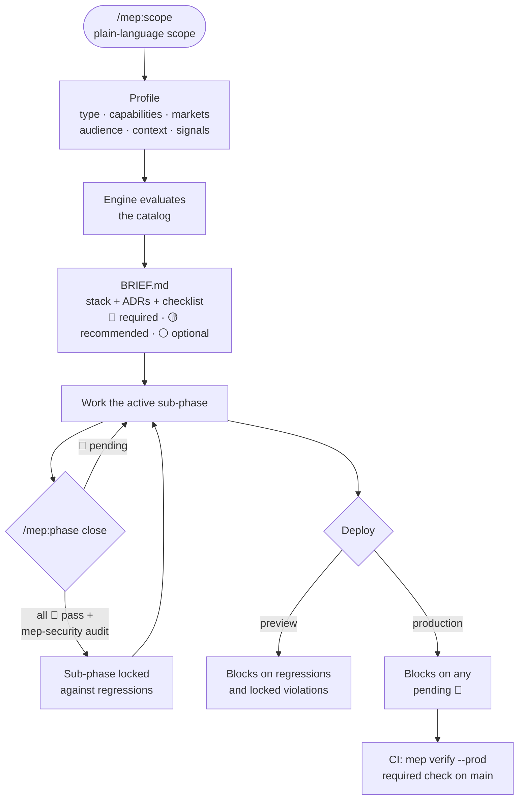

<div align="center">

# mise en place

**Scope → brief → verified checklist, for websites and webapps built with Claude Code.**<br>
You describe the project. mep knows what to ask and what to require.

[](LICENSE)
[](.claude-plugin/plugin.json)
[](catalog/CHANGELOG.md)
[](https://docs.claude.com/en/docs/claude-code/plugins)
[](https://github.com/DietrichGebert/ponytail)
[](https://github.com/engelbertgm/Baladero)
[](CONTRIBUTING.md)

**English** · [Español](README.es.md)

</div>

---

Most web projects ship without a canonical tag, with a table that has no RLS, or with a secret in the repo. Nobody asked for those things, so nobody built them. mep turns a plain-language scope into a **project profile**, filters a conditional catalog down to what applies, writes a **brief** with a justified stack and a checklist, and then **blocks** closing the work or deploying while required items are missing. A deterministic engine checks the repo, not the model.

## How it works



| Level | Effect |
| --- | --- |
| 🔴 required | Blocks by sub-phase. Always blocks a production deploy. Turned off only with `/mep:override`, a written reason and explicit confirmation |
| 🟡 recommended | Warns. Skipped only with `/mep:skip` and a written reason |
| ⚪ optional | Informs. Chosen during `/mep:scope` |
| 🔒 locked | Never turned off: secrets, RLS, password hashing, per-resource authorization, card data, HTTPS. A detected violation blocks at any time |

Sub-phases run in order: `foundation.setup → foundation.design → build.data → build.features → build.ux → launch.content → launch.seo → launch.ops`. Required items only block once their sub-phase is closed, so early work is not stuck behind launch checks.

| Agent | Model | Effort | Role |
| --- | --- | --- | --- |
| `mep-locator` | Haiku | low | Finds code and reusable pieces, reading `CODEMAP.md` and `REGISTRY.md` first. Read-only |
| `mep-security` | Opus | high | Implements and audits security items. Its reports in `.mep/security/` are the only thing that marks a security item as done |

> [!NOTE]
> A security item passes only when its automatic checks pass **and** `mep-security` left a current report. The report stores a hash of the files it reviewed, always including the sensitive files of that item's group (auth, payments, database, config); when any of them changes, the report expires and the item is pending again.

### What the agent cannot do

mep's blocks hold against the agent's own shortcuts, not just honest mistakes:

- **State changes only through the CLI.** `.mep/profile.yaml`, the log, reports and reviews are sealed with a hash after every write. An edit from outside the CLI blocks `mep verify` (locally and in CI, `MEP_BYPASS` included) until you run `/mep:resync`.
- **Your actions stay yours.** `/mep:confirm`, `/mep:override`, `/mep:threshold` (relaxing) and `/mep:resync` run only when you type them or press them in the panel; from the agent's Bash they are denied. Confirmations record your git user.
- **PRs need a real review.** The branch review is recorded (`mep review record --pr`) and tied to the code; retrying without it does not get through, and CI asks for it too.
- **Nothing is silent.** CI writes every state change of the PR (overrides, confirmations, phase closes, bypasses, re-seals) to the job summary, so you see it before merging.

On the same machine nothing is tamper-proof; a deliberate workaround is still visible in that summary.

## Works with

| Plugin | How they fit |
| --- | --- |
| [ponytail](https://github.com/DietrichGebert/ponytail) | Applies the code mantra on every change. `/ponytail-review` replaces mep's quality review when closing a sub-phase. The engine detects Ponytail and requires the review recorded (`mep review record`), with no "must fix" and on the current code, before the close |
| [baladero](https://github.com/engelbertgm/Baladero) | Live HUD for Claude Code: model, git, context and usage bars, tools, todos, and the cost of each task. mep's status line and panel show the checklist; Baladero shows what the session spends doing it |

Both are optional. mep works on its own.

## Requirements

- Claude Code (mods need 2.1.287 or later; older versions use the bundled hooks)
- Node.js 20 or later
- Projects in a git repository
- Recommended: the [ponytail](https://github.com/DietrichGebert/ponytail) plugin. mep works without it and uses its own quality review instead

## Install

```
/plugin marketplace add engelbertgm/Mise-en-place
/plugin install mep@mise-en-place
```

Then, in a new or existing project folder:

```
/mep:scope --preset saas "booking app for dance studios, Mexico and California, monthly plans"
```

> [!TIP]
> Try it without installing: `claude --plugin-dir <path-to-this-repo>`, then run `/mep:scope` in an empty folder.

## Usage

| Command | What it does |
| --- | --- |
| `/mep:scope [--preset <name>] <description>` | Asks only what changes 🔴 items, then writes `.mep/profile.yaml`, `SCOPE.md` (the scope in plain words: what is in, what is out), `BRIEF.md`, stack ADRs, the `CLAUDE.md` block and the CI workflow |
| `/mep:add <change>` | Updates the scope and shows **only the diff**: new items, items that move up a level, items that no longer apply |
| `/mep:check` | Status by sub-phase: ✅ done · ❌ pending · ⏭️ skipped · ⚠️ overridden. Warns about signals in the code the profile does not have |
| `/mep:phase [close <sub-phase>]` | Active sub-phase and what is missing; `close` runs the security audit and quality review, then closes it |
| `/mep:skip <id> <reason>` | Skips a 🟡 item |
| `/mep:override <id> <reason>` | Turns off a 🔴 item; rejects 🔒 items. Only you type it: the agent cannot |
| `/mep:panel` | Panel beside the chat: pending items by sub-phase; press one to see what it asks, why and everything that fails, and to confirm, skip or turn it off |
| `/mep:confirm <id>` · `/mep:threshold …` · `/mep:resync` | Your actions, never the agent's: confirm a manual item (recorded with your git user), relax a quality threshold, re-seal state changed outside the CLI |
| `/mep:audit [scope]` | For an existing repo: starts from the project's scope, compares it with what the code shows (code-only vs scope-only), and reports the gap with only the rules that scope activates. Changes nothing until you adopt the brief |
| `/mep:update` | Brings new catalog items that apply to your profile. Items that land in a closed sub-phase get a grace period |
| `/mep:quote [--client]` | Quote from the brief. Internal view (hours, rate, margins) or client view (price and estimated weeks per phase, extras, recurring costs, maintenance plans) |
| `/mep:export [--lang es]` | Client brief as .docx and .pdf, in the client's language, versioned, with what changed since the last version |
| `/mep:log-time <id> <hours>` | Logs real hours per item outside the repo; with enough data, mep suggests new ranges |

Code quality thresholds (complexity 10, 300 lines per file, 50 per function) live in the profile; relaxing one needs a reason: `mep threshold complexity 15 "<reason>" --yes`, marked ⚠️ in the brief.

The quote runs by itself only when the scope is defined (`/mep:scope`) or changes (`/mep:add`, which shows the impact in hours and price before you accept). Rates, real hours and internal quotes live in `~/.config/mep-check/`, never in the repo.

Presets: `landing`, `corporate`, `ecommerce`, `saas`, `marketplace`.

Checks run on the code, on the build output and, when the profile has `urls.preview`/`urls.production` (or `MEP_URL` is set), on the deployed site and its DNS: the headers it really sends, cookies, compression and caching, a real 404, canonical redirects, the sitemap, and SPF/DMARC/DKIM.

Out of scope by design: projects for minors, or that need age verification (adult content, gambling, alcohol…). `/mep:scope` stops, and a profile with that audience is invalid.

Every rule is activated by the project's scope (type, capabilities, markets, audience, context, signals), never by default: a landing without accounts gets no RLS rules, a site without cookies gets no consent banner. `mep explain <id>` shows the rule's condition with ✓/✗ and why it applies or not.

<details>
<summary><b>Project profile</b> (<code>.mep/profile.yaml</code>, the source of truth)</summary>

```yaml
project: "dance-studio"
phase:
  closed: [foundation.setup]
  active: foundation.design
type: saas
capabilities: [auth, payments, subscriptions, email]
markets: [MX, USA:CA]
audience: [b2c]
context: client-project
counts: { pages: 12, entities: 6, languages: 2, integrations: 3 }
signals:
  has_forms: true
  has_db: true
  db_client_access: true
  has_dates: true
selections:
  optional_added: []
  recommended_skipped:
    - { id: csp-strict, reason: "MVP; added after launch", date: 2026-10-12 }
  overrides: []
stack:
  decided: { framework: nextjs, hosting: vercel, db: postgresql }
```

Only values from [`catalog/dimensions.yaml`](catalog/dimensions.yaml) are accepted. Capabilities turn on signals by themselves (`auth` → forms, database, personal data); more than one language turns on `i18n`.

</details>

<details>
<summary><b>Catalog item</b> (one entry in <code>catalog/items/*.yaml</code>)</summary>

```yaml
- id: rls-all-tables
  title: RLS enabled on every table
  category: security
  level: required
  phase: build.data
  locked: true
  since: "2026.10.1"
  effort: { size: M, hours: [2, 6], scales_with: entities }
  when: { signals: { has_db: true, db_client_access: true } }
  why: "With direct client access (Supabase), a table without RLS is public to anyone with the anon key."
  how: "Every create table in migrations has its enable row level security."
  verify:
    - { type: sql, rule: rls_enabled }
```

Verify types: `file_exists`, `route_exists` (Next.js, Astro, Vite/React, static), `grep` (present or absent), `json_key`, `command`, `html` (rules on the build output: unique titles, one `h1`, heading order, meta tags…), `sql` (RLS in migrations) and `manual`. The engine runs them all, never the model.

</details>

<details>
<summary><b>When it blocks</b></summary>

| Moment | Blocks on |
| --- | --- |
| Ending a turn (Stop) | 🔴 items of **closed** sub-phases (regressions) and 🔒 violations. Pending 🔴 items of the active sub-phase are shown as info |
| Preview deploy (`vercel`, `netlify deploy`) | Same as Stop |
| Production deploy (`vercel --prod`, push to `main`) | Any pending 🔴, in every sub-phase |
| Opening or merging a PR into `main` | Once per commit: a quality review first (`/ponytail-review branch`, or mep's own review) |
| Pull request to `main` | `mep verify --prod` in CI. This is the real barrier: production deploys usually run on merge, where Claude Code hooks do not |
| Writing a file | A secret written into a versioned file is refused |

Nothing runs in a repo without `.mep/profile.yaml`. Emergency escape: `MEP_BYPASS=1` (never for 🔒 items; logged in `.mep/log`).

</details>

<details>
<summary><b>What lives where</b></summary>

| In the repo (versioned) | Outside the repo (`~/.config/mep-check/`) |
| --- | --- |
| `.mep/profile.yaml`, `.mep/log`, `.mep/security/`, `SCOPE.md`, `BRIEF.md`, `docs/decisions/` | Rates, real hours, internal quotes |

In a `client-project` the repo is handed to the client, so nothing internal to your business stays in it.

</details>

## Folder structure

### This repository

```
Mise-en-place/
├── .claude-plugin/
│   ├── plugin.json            # plugin manifest
│   └── marketplace.json       # makes the repo installable with /plugin
├── skills/                    # each folder is a /mep:<name> command
│   ├── mep/                   # guide: read a scope, use the catalog, respect the brief
│   ├── scope/  add/  check/  phase/  skip/  panel/  audit/  update/
│   ├── override/  confirm/  threshold/  resync/   # yours only (disable-model-invocation)
│   └── quote/  export/  log-time/
├── agents/
│   ├── mep-locator.md         # Haiku, read-only: finds code through the maps
│   └── mep-security.md        # Opus: implements and audits security items
├── hooks/
│   └── hooks.json             # mods module + fallback hooks (SessionStart, Stop, PreToolUse, PostToolUse)
├── mods/
│   ├── register.tsx           # gate, guard, panel, instant commands and status line
│   └── register.test.ts       # mod tests (claude plugin test .)
├── types/index.d.ts           # the mod's state contract (panel)
├── engine/
│   ├── src/                   # deterministic engine in TypeScript, no LLM
│   │   ├── evaluate.ts        # profile + catalog → items that apply, diff, stack
│   │   ├── verify.ts          # runs each item's checks (html.ts, sql.ts, maps.ts)
│   │   ├── gate.ts            # blocking rules and phase close
│   │   ├── seal.ts guard.ts   # state sealed after every write; what the agent may not touch
│   │   ├── human.ts           # actions only the person takes
│   │   ├── live.ts            # checks against the deployed site and its DNS
│   │   ├── render.ts          # BRIEF.md, ADRs, CLAUDE.md block
│   │   ├── scope.ts           # SCOPE.md: the scope in plain words
│   │   ├── audit.ts           # infers a profile from an existing repo
│   │   ├── update.ts          # new catalog items, grace period
│   │   ├── quote.ts           # quote, log-time, calibration
│   │   ├── export.ts docs.ts  # client brief → .docx and .pdf
│   │   └── cli.ts             # the `mep` command that skills, mods, hooks and CI call
│   └── dist/mep.mjs           # bundle with no runtime dependencies (committed)
├── catalog/
│   ├── dimensions.yaml        # valid values: types, capabilities, markets, signals, phases
│   ├── items/                 # one file per category (base, seo, security, ux, legal…)
│   ├── markets/               # one file per market (mx, usa, ca, eu, uk, br, in)
│   ├── presets/               # landing, corporate, ecommerce, saas, marketplace
│   ├── stack-rules.yaml       # stack recommendations with their reason
│   ├── signals.yaml detect.yaml  # what the code reveals (signals, capabilities)
│   ├── costs.yaml codemap.yaml sensitive.yaml
│   ├── VERSION
│   └── CHANGELOG.md
├── templates/
│   ├── claude-md.md           # block added to the project's CLAUDE.md
│   ├── ci/mep.yml             # CI workflow installed in each project
│   ├── tests/responsive.spec.ts  # Playwright responsive test installed in each project
│   └── client-brief/          # client brief template (es, en)
├── examples/estudio-saas/     # test project used by tests/e2e.spec.ts
├── tests/                     # engine, CLI and end-to-end tests (node:test)
└── docs/spec.md               # full specification (Spanish)
```

### What mep adds to your project

```
your-project/
├── .mep/
│   ├── profile.yaml           # source of truth: type, capabilities, markets, signals, phase
│   ├── log                    # overrides, bypasses, phase changes, confirmations; sealed
│   ├── security/<id>.json     # mep-security audit reports
│   ├── reviews/<sub|pr>.json  # quality reviews (phase close, PR)
│   └── exports.yaml           # client brief versions
├── SCOPE.md                   # generated: what the project is and is not, in plain words
├── BRIEF.md                   # generated brief: profile, stack, checklist by sub-phase
├── CLAUDE.md                  # + the mep block (what was there is kept)
├── CODEMAP.md                 # where things are
├── REGISTRY.md                # reusable pieces
├── docs/
│   ├── decisions/             # ADRs, starting with the stack decisions
│   └── client/brief-vN.*      # client brief (.md, .docx, .pdf)
├── tests/responsive.spec.ts   # 360–2560 px, no horizontal scroll, no overlaps (Playwright)
└── .github/workflows/mep.yml  # mep verify --prod as a required check

~/.config/mep-check/           # outside the repo: never handed to the client
├── rates.yaml                 # your rates
├── quotes/<project>/          # internal quotes
└── actuals/<project>.yaml     # real hours for calibration
```

## Under the hood

- **Engine** ([`engine/src`](engine/src)): TypeScript, no LLM. Same profile, same items, same result. Bundled to [`engine/dist/mep.mjs`](engine/dist/mep.mjs) with no runtime dependencies, and published as `@engelbertgm/mep` for CI.
- **Mods** ([`mods/register.tsx`](mods/register.tsx)): run inside Claude Code. The chat only hears from mep when something blocks; the status line shows the active sub-phase and pending 🔴/🟡; the panel (`/mep:panel`) shows each item's why, how and every finding, with your actions (confirm, skip, turn off through a dialog). `/mep:check` and `/mep:phase` answer instantly; deploys (Vercel, Netlify, Cloudflare, Fly, Railway, Firebase, Supabase, `git push` to main) wait for the engine's gate; edits to mep's state and secrets in versioned files are denied.
- **Hooks** ([`hooks/hooks.json`](hooks/hooks.json)): SessionStart, Stop, PreToolUse (gate and guard) and PostToolUse, as the fallback where mods are not available.
- **CI** ([`templates/ci/mep.yml`](templates/ci/mep.yml)): installed by `/mep:scope`. Runs gitleaks, `pnpm audit`, the build and `mep verify --prod` (with `--pr` on pull requests, and against `MEP_URL` for the live checks), and writes the PR's state changes to the job summary.
- **Maps**: `mep codemap` and `mep registry` generate `CODEMAP.md` and `REGISTRY.md` from the code. "What for" and "Do not use for" are written in each export's doc comment; an export without an entry blocks once its sub-phase is closed.
- **Export**: a small Markdown subset becomes .docx and .pdf with no dependencies, so it works on any machine.
- **Catalog** ([`catalog/`](catalog)): 400 items across accessibility, design system, UX, content, forms, data, responsive, security, privacy, legal, performance, i18n, code quality, deploy and operations; rules per project type (SaaS, ecommerce, marketplace, booking, blog, directory, portfolio, internal app), usage-based billing, health and finance data, and the MX, USA, CA, EU, UK, BR and IN markets, each legal item with its official source or a confirmation from you.

### Test project

[`examples/estudio-saas`](examples/estudio-saas) is a fictitious SaaS (auth and payments, MX + USA:CA + EU:DE). [`tests/e2e.spec.ts`](tests/e2e.spec.ts) runs the whole flow on it: audit, scope, closing a sub-phase with the security audit, regressions, a secret in the code, the production gate, a scope change with its quote impact, the client export and a catalog update.

## Limitations

> [!WARNING]
> mep is a guided checklist, not legal advice. Legal items cite official sources, but a lawyer should review them for your market.

- The CI check only blocks merges once you mark it as **required** in the repo's branch protection settings.
- HTML checks need a build output (`out/`, `.next/server/app`, `dist/`). Without one, those items stay pending instead of passing.
- Many UX, legal and design items are `manual`: the engine tracks them, but you (or `mep-security`, for security) confirm them.
- Live and DNS checks need the deployed site (`urls` in the profile, or `MEP_URL`); without it they are skipped, and items that depend only on them stay pending.
- The guard and the seal stop the obvious shortcuts; a deliberate workaround on the same machine is not prevented, only shown in the PR summary.
- Prices in `catalog/costs.yaml` and effort ranges are estimates; check current prices and calibrate with `/mep:log-time`.

The full design is in [docs/spec.md](docs/spec.md) (Spanish).

## Development

```
pnpm install
pnpm test                 # builds the engine, then runs its tests
pnpm typecheck
claude plugin test .      # mod tests
claude plugin validate .
```

After changing `engine/src`, run `pnpm build` and commit `engine/dist/mep.mjs`; CI checks they match.

## Contributing

See [CONTRIBUTING.md](CONTRIBUTING.md) and the [Code of Conduct](CODE_OF_CONDUCT.md). Report vulnerabilities privately as described in [SECURITY.md](SECURITY.md).

## License

[Business Source License 1.1](LICENSE). Free to use, including on paid client projects, for:

- individuals (freelance designers and developers),
- teams of up to 5 people,
- non-commercial, educational and non-profit use.

Larger organizations need a commercial license; [contact the author](https://github.com/engelbertgm). No one may resell mep or offer it as a competing paid product or service. Each version becomes [Apache-2.0](https://www.apache.org/licenses/LICENSE-2.0) four years after its release.
