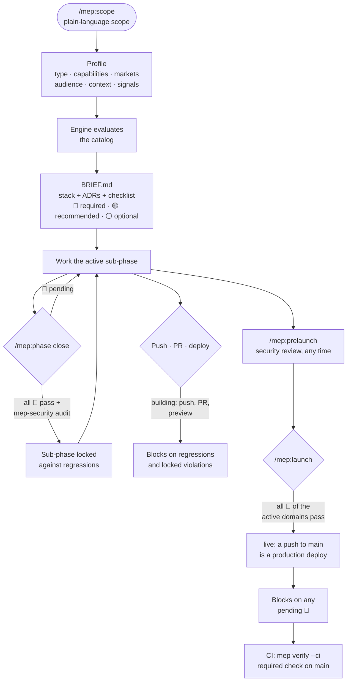

<div align="center">

# mise en place

**Scope → brief → verified checklist, for websites and webapps built with Claude Code.**<br>
You describe the project. mep knows what to ask and what to require.

[](LICENSE)
[](.claude-plugin/plugin.json)
[](catalog/CHANGELOG.md)
[](https://docs.claude.com/en/docs/claude-code/plugins)
[](https://github.com/DietrichGebert/ponytail)
[](https://github.com/engelbertgm/Baladero)
[](CONTRIBUTING.md)

**English** · [Español](README.es.md)

</div>

---

Most web projects ship without a canonical tag, with a table that has no RLS, or with a secret in the repo. Nobody asked for those things, so nobody built them. mep turns a plain-language scope into a **project profile**, filters a conditional catalog down to what applies, writes a **brief** with a justified stack and a checklist, and then **blocks** closing the work or deploying while required items are missing. A deterministic engine checks the repo, not the model.

## How it works



**The rules are guidelines for building, not tasks to tick off.** While you build, the agent keeps `BRIEF.md` in mind the way you would say "make the site, and consider accessibility and WCAG": it writes the real thing well the first time. Pending items during construction are normal; mep tells the agent never to create placeholder pages, throwaway sites or filler code just to make a check pass, and not to walk the checklist item by item. Checks run at the checkpoints (closing a sub-phase, `/mep:prelaunch`, `/mep:launch`, CI), on what actually exists.

You never have to close a sub-phase to push. A project starts **building**: a push or PR to `main` only stops on secrets, 🔒 violations and regressions in sub-phases you already closed. `/mep:launch` runs the full gate once; if it passes, the project goes **live** and every push to `main` is a production deploy.

| Level | Effect |
| --- | --- |
| 🔴 required | Blocks a sub-phase only if you close it. Blocks go-live and, once live, every deploy. Can be postponed with `/mep:defer` (still required at go-live) or turned off with `/mep:override`, a written reason and explicit confirmation |
| 🟡 recommended | Warns. Skipped only with `/mep:skip` and a written reason |
| ⚪ optional | Informs. Chosen during `/mep:scope` |
| 🔒 locked | Never turned off: secrets, RLS, password hashing, per-resource authorization, card data, HTTPS. A detected violation blocks at any time |

Sub-phases run in order: `foundation.setup → foundation.design → build.data → build.features → build.ux → launch.content → launch.seo → launch.ops`. They are a suggested order, not a gate: closing one is optional and only protects what you did against regressions, so early work is never stuck behind launch checks.

| Agent | Model | Effort | Role |
| --- | --- | --- | --- |
| `mep-locator` | Haiku | low | Finds code and reusable pieces, reading `CODEMAP.md` and `REGISTRY.md` first. Read-only |
| `mep-security` | Opus | high | Implements and audits security items. Its reports in `.mep/security/` are the only thing that marks a security item as done |

> [!NOTE]
> A security item passes only when its automatic checks pass **and** `mep-security` left a current report. The report stores a hash of the files it reviewed, always including the sensitive files of that item's group (auth, payments, database, config); when any of them changes, the report expires and the item is pending again.

### What the agent cannot do

mep's blocks hold against the agent's own shortcuts, not just honest mistakes:

- **State changes only through the CLI.** `.mep/profile.yaml`, the log, reports and reviews are sealed with a hash after every write. An edit from outside the CLI blocks `mep verify` (locally and in CI, `MEP_BYPASS` included) until you run `/mep:resync`.
- **Your actions stay yours.** `/mep:confirm`, `/mep:override`, `/mep:defer`, `/mep:domain off`, `/mep:threshold` (relaxing), `/mep:resync` and going back to building (`mep stage building`) run only when you type them or press them in the panel; from the agent's Bash they are denied. Confirmations record your git user.
- **PRs need a real review.** The branch review is recorded (`mep review record --pr`) and tied to the code; retrying without it does not get through, and CI asks for it too.
- **Nothing is silent.** CI writes every state change of the PR (overrides, confirmations, phase closes, bypasses, re-seals) to the job summary, so you see it before merging.

On the same machine nothing is tamper-proof; a deliberate workaround is still visible in that summary.

### Planning documents

mep keeps a written plan in `docs/plan/`, so every session builds against the same plan instead of memory:

| Document | What it answers | Written |
| --- | --- | --- |
| `PRD.md` | What is built, for whom, and how success is measured | `/mep:scope` |
| `TRD.md` | Stack, architecture, environments, non-functional requirements | `/mep:scope` |
| `IMPLEMENTATION.md` | Phases, milestones and schedule | `/mep:scope` |
| `FLOWS.md` | Every screen and every main user journey | start of `foundation.design` |
| `SCHEMA.md` | Tables, relationships, auth and row-level security | start of `build.data` (only with a database) |

Each one has fixed sections and diagrams made with [diagram-design](https://github.com/cathrynlavery/diagram-design). The engine checks that they exist and that they match the code: a page route missing from `FLOWS.md`, or a migration table missing from `SCHEMA.md`, puts the item back to pending. For client projects, `/mep:export` also produces non-technical versions of PRD, FLOWS and IMPLEMENTATION, with the client-safe diagrams. Any of them converts to .docx and .pdf with `mep export --in docs/plan/<DOC>.md`.

There is no separate command for them: `/mep:scope` writes the first three, the `mep` skill writes FLOWS and SCHEMA when their sub-phase starts, `/mep:add` updates them when the scope changes, `/mep:update` writes the missing ones in projects already underway, and the `plan-*` items in the checklist say which are missing or out of date.

### Tailored to the scope, not to a type

The catalog is a **general guide**, not a checklist per project type. At `/mep:scope`, Claude builds the profile from concrete facts, then goes through what the catalog proposes and fits it to *this* project: it keeps what applies, drops what does not (with a reason), adapts what applies differently (a note), and adds what is missing. If it is unsure, it asks (a few questions at a time). 🔒 items are never fitted out.

- Left-out items are recorded in `tailoring.not_applicable` (`id` + `reason`) and adapted ones in `tailoring.notes` of the profile. They show as `off` ("does not apply to this scope"), stop counting, and appear in `BRIEF.md` (🎯 note, "Adjusted to this scope") and `SCOPE.md` ("A tu medida").
- `/mep:add` and `/mep:audit` fit again when the scope changes.

### Domains

Every item lives in one **domain** and **subdomain** (`ui.motion`, `security.abuse`, `payments.checkout`, `quality.typescript`…): UI, UX, accessibility, frontend, languages (i18n), backend, accounts & access, payments, database, security, privacy, legal, SEO, content, product by type, analytics, infrastructure, and quality by language. [`catalog/domains.yaml`](catalog/domains.yaml) is the single source of each item's home, and also holds the **links**: an item can show in other subdomains as a suggestion (↗), while its state and level stay where it lives.

- `/mep:domains` shows progress per domain with a braille bar; `/mep:focus <domain[.subdomain]>` lists what is pending there, linked items included.
- Work by area if you prefer: the panel groups by sub-phase or by domain.
- Panel and domain names are in English.
- A domain or subdomain can be switched off whole (`/mep:domain off backend.queues "another team owns it"`): its items stop counting, 🔒 stay on, and it is marked ⚠️ in `BRIEF.md` and the PR summary.
- What does not apply to the scope is already out by the item's own condition. Languages follow what the code uses: `has_typescript`, `has_css`, `has_sql`, `has_python`, `has_react`… turn their quality rules on or off.

### Security review before going live

`/mep:prelaunch` is your own security checklist, line by line, in plain words. Each line is made of catalog items, and a line whose items do not apply to the scope shows as "not applicable" (no uploads, no admin, no payments…). It changes nothing and runs any time, so you can fix things early; `/mep:launch` asks for the same items together with everything else.

| # | Line | Items behind it |
| --- | --- | --- |
| 1 | Passwords stored hashed (argon2 or bcrypt) | `password-hashing` 🔒 |
| 2 | API keys only on the server, never in the browser | `server-only-keys`, `public-env-prefix` |
| 3 | The database shows each person only their own data | `rls-all-tables`, `rls-policies-per-operation`, `resource-authorization`, `db-least-privilege` |
| 4 | HTTPS forced everywhere | `https-hsts` |
| 5 | Every form checked on the server, not only on the page | `form-server-validation` |
| 6 | XSS blocked and safe queries, so nobody sneaks in SQL | `no-raw-html`, `csp-strict`, `no-sql-injection` |
| 7 | Rate limits on login and submissions | `auth-rate-limit`, `form-rate-limit` |
| 8 | CSRF protection | `csrf-protection` |
| 9 | Secure session cookies | `secure-session-cookies` |
| 10 | Password-reset links expire (≤ 1 hour, single use) | `password-reset-expiry`, `password-recovery` |
| 11 | Uploads under control: allowed formats only, size caps, content checked, served safely | `upload-validation`, `upload-type-allowlist`, `upload-size-limits`, `upload-content-hardening`, `upload-antivirus`, `upload-served-safely` |
| 12 | Admin pages locked | `admin-roles`, `admin-mfa` |
| 13 | Every price rechecked on the server | `server-side-prices` 🔒 |
| 14 | Debug mode off: details go to private logs, users only see a message | `production-errors-hidden`, `debug-mode-off` |
| 15 | Risky packages updated and unused ones removed | `no-critical-vulnerabilities`, `dependency-scan-ci`, `unused-dependencies` |
| 16 | Git history scanned for leaked keys; any found are rotated | `secrets-scan-ci`, `secrets-history-clean`, `key-rotation-procedure` |

Each line shows ✅ done · ❌ something is missing (and what) · ❔ needs commands or the build to run (`--full`) · ⊘ not applicable. Security items only count with a current `mep-security` report. `--full` runs `gitleaks` and `knip`, which need to be installed on your machine.

The lines live in [`catalog/prelaunch.yaml`](catalog/prelaunch.yaml). The checks on uploads go beyond the type: a short allowlist per use (extension, real type and declared Content-Type must agree), images re-encoded, SVG and PDF without active code, archives with caps, and files served from another origin with `nosniff`.

### The panel

`/mep:panel` opens a panel beside the chat (it also opens by itself when a project has mep). Each line is `NAME … braille bar  red yellow white`: the bar fills as required items pass and moves from red to green, and the three numbers are the pending 🔴, 🟡 and chosen ⚪ items in their own colors. Inside a category, items sit under a heading per level (`Required (12)` in red, `Recommended (4)` in yellow), each with its circle: ● red required, ● yellow recommended, ○ white optional. The heading names the level, so it reads even where a surface does not show color.

- **By sub-phase or by domain:** a toggle switches the grouping; in the domain view, items linked from other domains appear with ↗.
- **Stage at a glance:** whether a push is only an integration (building) or a production deploy (live).
- **An item:** why, how, what is missing (first six findings, the rest behind "more"), and your actions: confirm, skip, postpone until go-live, or turn off through a dialog.
- **⇢ Flow:** which command to run and when, as a line of steps (define the scope → work → decisions only you take → push → before going live → go live → after). It lists every `/mep:` command, marks where you are (✓ done, ▶ here, ○ ahead), and a click writes the command in the chat box with its arguments left to type; you press Enter. Where the surface draws its own chat (VS Code), it is copied to the clipboard instead.
- **⚙ Tools:** instant commands, the ones that take a turn from Claude, text inputs for `/mep:scope`, `/mep:add` and `/mep:log-time`, and the questions "can I deploy to production?" and "can I open a PR to main?".
- **A braille spinner** turns while the engine works. Colors sit outside the buttons and, off the terminal, use fixed colors, because some surfaces restyle a button's label.

### Guidelines and quality gates

[`catalog/guidelines.md`](catalog/guidelines.md) holds the design, UX, copy and code principles mep works by: Nielsen, Norman, Shneiderman, the laws of UX, Maeda and Rams, Cialdini and positioning, KISS, YAGNI, DRY, SOLID, Gall, Conway and Twelve-Factor. Claude reads only the section of the active sub-phase (visual design in `foundation.design`, interaction and usability in `build.ux`, copy and conversion in `launch.content` for landing, ecommerce, marketplace and SaaS), and the close review checks key screens against it.

What can be measured is a check, not a principle:

| Area | Checks |
| --- | --- |
| Interface | touch targets ≥ 44×44 px and one primary CTA per view (responsive test), contrast, focus, spacing scale, 2 font families, 45–75 characters per line, every async state, no dark patterns |
| Code (JS/TS) | complexity ≤ 10, files ≤ 300 lines, functions ≤ 50 lines, ≤ 4 parameters, no import cycles, strict types, no duplicated or dead code (jscpd and knip actually run) |
| Code (TypeScript) | no `@ts-ignore`, type-aware lint (no floating promises), `noUncheckedIndexedAccess`, external data validated with a schema |
| Code (Python) | Ruff with the same limits plus its security rules, mypy --strict, pytest, a lockfile with pip-audit, vulture; only in projects with `pyproject.toml`, `requirements*.txt` or `uv.lock` |
| CSS · HTML · SQL | Stylelint, no `!important`, CSS size; valid, semantic HTML without inline handlers; SQL lint, safe migrations, indexed foreign keys |
| Frameworks · CI | React hooks and jsx-a11y lint, `"use client"` only where needed; actionlint, shellcheck, hadolint, `.editorconfig` with LF line endings |
| Architecture | Twelve-Factor (config validated from env, stateless server, logs to stdout, pinned runtime) and, if you want it, what exists deployed to preview early (Gall's law; optional, never a placeholder page) |
| Systems design | idempotency keys, caching and CDN, message queues, a shared-store rate limit with 429, circuit breakers and timeouts, structured logs, metrics and traces; with `high_traffic` also load balancing, replicas and recovery, a consistency (CAP) model, sharding and consistent hashing |
| Honesty and privacy | no fake reviews, claims with evidence, a notice beside every form, data minimization, an audit of third-party SDKs, business identity on the page |

The languages are not hard-coded: each group turns on with a signal the code reveals (`has_typescript`, `has_css`, `has_html`, `has_sql`, `has_python`, `has_react`, `has_tailwind`, `has_ci`, `has_shell`, `has_docker`). PHP, Ruby, Go and Rust can be added with the same template as Python when someone uses them.

## Works with

| Plugin | How they fit |
| --- | --- |
| [ponytail](https://github.com/DietrichGebert/ponytail) | Applies the code mantra on every change. `/ponytail-review` replaces mep's quality review when closing a sub-phase. The engine detects Ponytail and requires the review recorded (`mep review record`), with no "must fix" and on the current code, before the close |
| [diagram-design](https://github.com/cathrynlavery/diagram-design) | Draws the diagrams of the planning documents (journey, architecture, flowcharts, sequence, database schema, Gantt). Required to write them; its PNG export needs Python and Playwright |
| [baladero](https://github.com/engelbertgm/Baladero) | Live HUD for Claude Code: model, git, context and usage bars, tools, todos, and the cost of each task. mep's status line and panel show the checklist; Baladero shows what the session spends doing it |

ponytail and baladero are optional. diagram-design is required for the planning documents.

## Requirements

- Claude Code (mods need 2.1.287 or later; older versions use the bundled hooks)
- Node.js 20 or later
- Projects in a git repository
- The [diagram-design](https://github.com/cathrynlavery/diagram-design) plugin (2.6.136 or later), with Python and Playwright for its PNG export, to write the planning documents
- Recommended: the [ponytail](https://github.com/DietrichGebert/ponytail) plugin. mep works without it and uses its own quality review instead
- Optional, for `mep prelaunch --full`: `gitleaks` and `knip` installed locally

## Install

```
/plugin marketplace add engelbertgm/Mise-en-place
/plugin install mep@mise-en-place
```

Then, in a new or existing project folder:

```
/mep:scope --preset saas "booking app for dance studios, Mexico and California, monthly plans"
```

The plugin's instructions to the model (skills, agents and the `CLAUDE.md` block mep adds to a project) are written in English because it costs fewer tokens; the assistant still talks to you in your language, and the panel, the engine's messages and the catalog are in Spanish.

To update later: `claude plugin marketplace update mise-en-place`, then `claude plugin update mep@mise-en-place`, and restart Claude Code (`/exit`, then `claude --continue`). `claude plugin list` shows the version.

> [!TIP]
> Try it without installing: `claude --plugin-dir <path-to-this-repo>`, then run `/mep:scope` in an empty folder.

## Usage

| Command | What it does |
| --- | --- |
| `/mep:scope [--preset <name>] <description>` | Asks only what changes 🔴 items, then writes `.mep/profile.yaml`, `SCOPE.md` (the scope in plain words: what is in, what is out), `BRIEF.md`, stack ADRs, the `CLAUDE.md` block, the CI workflow, and the PRD, TRD and implementation plan with their diagrams |
| `/mep:add <change>` | Updates the scope and shows **only the diff**: new items, items that move up a level, items that no longer apply. Updates the planning documents it affects |
| `/mep:check` | Status by sub-phase: ✅ done · ❌ pending · ⏭️ skipped · ⚠️ overridden. Warns about signals in the code the profile does not have |
| `/mep:phase [close <sub-phase>]` | Active sub-phase and what is missing; `close` (optional) runs the security audit and quality review, then closes it |
| `/mep:domains [domain]` · `/mep:focus <path>` | Progress by domain and subdomain; what is pending in one, with the items linked from other domains (↗) |
| `/mep:prelaunch [--full]` | Security review before going live, line by line (password hashing, keys on the server, database access, HTTPS, XSS/SQL, rate limits, CSRF, cookies, uploads, admin, prices, debug, packages, git history). Changes nothing; run it any time |
| `/mep:launch` | Go-live: runs the full gate once. If it passes, the project is live and a push to `main` is a production deploy |
| `/mep:defer <id> <reason>` · `/mep:domain off <path> <reason>` | Your actions: postpone a 🔴 until go-live (`defer undo <id>` brings it back); switch a whole domain off |
| `/mep:skip <id> <reason>` | Skips a 🟡 item |
| `/mep:override <id> <reason>` | Turns off a 🔴 item; rejects 🔒 items. Only you type it: the agent cannot |
| `/mep:panel` | Panel beside the chat: pending items by sub-phase or by domain, plus a **Flow** button (which command to run and when; a click writes it in the chat); press one to see what it asks, why and everything that fails, and to confirm, skip or turn it off |
| `/mep:confirm <id>` · `/mep:threshold …` · `/mep:resync` | Your actions, never the agent's: confirm a manual item (recorded with your git user), relax a quality threshold, re-seal state changed outside the CLI |
| `/mep:audit [scope]` | For an existing repo: starts from the project's scope, compares it with what the code shows (code-only vs scope-only), and reports the gap with only the rules that scope activates. Changes nothing until you adopt the brief |
| `/mep:update` | Brings new catalog items that apply to your profile, marked ＋ new or ✎ changed. Items that land in a closed sub-phase get a grace period. Writes planning documents the project is missing |
| `/mep:quote [--client]` | Quote from the brief. Internal view (hours, rate, margins) or client view (price and estimated weeks per phase, extras, recurring costs, maintenance plans) |
| `/mep:export [--lang es]` | Client brief as .docx and .pdf, in the client's language, versioned, with what changed since the last version; for client projects, also the PRD, flows and implementation plan, with their diagrams |
| `/mep:log-time <id> <hours>` | Logs real hours per item outside the repo; with enough data, mep suggests new ranges |

Code quality thresholds (complexity 10, 300 lines per file, 50 per function, 4 parameters) live in the profile and apply to JS/TS and Python alike; relaxing one needs a reason: `mep threshold complexity 15 "<reason>" --yes`, marked ⚠️ in the brief.

The quote runs by itself only when the scope is defined (`/mep:scope`) or changes (`/mep:add`, which shows the impact in hours and price before you accept). Rates, real hours and internal quotes live in `~/.config/mep-check/`, never in the repo.

Presets: `landing`, `corporate`, `ecommerce`, `saas`, `marketplace`.

Checks run on the code, on the build output and, when the profile has `urls.preview`/`urls.production` (or `MEP_URL` is set), on the deployed site and its DNS: the headers it really sends, cookies, compression and caching, a real 404, canonical redirects, the sitemap, and SPF/DMARC/DKIM.

Out of scope by design: projects for minors, or that need age verification (adult content, gambling, alcohol…). `/mep:scope` stops, and a profile with that audience is invalid.

Every rule is activated by the project's scope (type, capabilities, markets, audience, context, signals), never by default: a landing without accounts gets no RLS rules, a site without cookies gets no consent banner. `mep explain <id>` shows the rule's condition with ✓/✗ and why it applies or not.

<details>
<summary><b>Project profile</b> (<code>.mep/profile.yaml</code>, the source of truth)</summary>

```yaml
project: "dance-studio"
phase:
  closed: [foundation.setup]
  active: foundation.design
type: saas
capabilities: [auth, payments, subscriptions, email]
markets: [MX, USA:CA]
audience: [b2c]
context: client-project
counts: { pages: 12, entities: 6, languages: 2, integrations: 3 }
signals:
  has_forms: true
  has_db: true
  db_client_access: true
  has_dates: true
  has_typescript: true    # also has_javascript, has_css, has_html (default true), has_sql, has_react…
  high_traffic: false     # only the scope can say it: turns on the scale rules
tailoring:               # Claude's fit of the catalog to this scope
  not_applicable:
    - { id: saas-trial-flow, reason: "no free trial; paid from day one" }
  notes:
    pricing-page: "two plans only; no enterprise tier"
selections:
  optional_added: []
  recommended_skipped:
    - { id: csp-strict, reason: "MVP; added after launch", date: 2026-10-12 }
  overrides: []
stage: building           # building | live (mep launch)
selections:
  domains_off: []         # { path: backend.queues, reason, date }: whole domains switched off
  deferred: []            # { id, reason, date }: 🔴 postponed until go-live
stack:
  decided: { framework: nextjs, hosting: vercel, db: postgresql }
```

Only values from [`catalog/dimensions.yaml`](catalog/dimensions.yaml) are accepted. Capabilities turn on signals by themselves (`auth` → forms, database, personal data); more than one language turns on `i18n`.

</details>

<details>
<summary><b>Catalog item</b> (one entry in <code>catalog/items/*.yaml</code>)</summary>

```yaml
- id: rls-all-tables
  title: RLS enabled on every table
  category: security
  level: required
  phase: build.data
  locked: true
  since: "2026.10.1"
  effort: { size: M, hours: [2, 6], scales_with: entities }
  when: { signals: { has_db: true, db_client_access: true } }
  why: "With direct client access (Supabase), a table without RLS is public to anyone with the anon key."
  how: "Every create table in migrations has its enable row level security."
  verify:
    - { type: sql, rule: rls_enabled }
```

The item has no `domain` of its own: its home (`database.access`…) and its links to other subdomains are in [`catalog/domains.yaml`](catalog/domains.yaml), and the catalog does not load if an item has none.

Verify types: `file_exists`, `route_exists` (Next.js, Astro, Vite/React, static), `grep` (present or absent), `json_key`, `command`, `html` (rules on the build output: unique titles, one `h1`, heading order, meta tags…), `sql` (RLS in migrations), `maps`, `quality`, `design`, `build` (server-rendered HTML, bundle size, source maps), `robots`, `live` and `dns` (the deployed site), `plan` (planning documents) and `manual`. The engine runs them all, never the model.

</details>

<details>
<summary><b>When it blocks</b></summary>

| Moment | Blocks on |
| --- | --- |
| Ending a turn (Stop) | 🔴 items of **closed** sub-phases (regressions) and 🔒 violations. Pending 🔴 items of the active sub-phase are shown as info |
| Preview deploy (`vercel`, `netlify deploy`) | Same as Stop |
| Push to `main` while **building** | Same as Stop: regressions, 🔒 and secrets. Pending 🔴 do not block |
| Explicit production deploy (`vercel --prod`…), or any push to `main` once **live** | Any pending 🔴, in every sub-phase of the active domains (postponed ones included) |
| `/mep:launch` | The same full gate; if it passes, the project becomes live |
| Opening or merging a PR into `main` | Once per commit: a quality review first (`/ponytail-review branch`, or mep's own review) |
| Pull request to `main` | `mep verify --ci` in CI (building: regressions; live: the full gate). This is the real barrier: production deploys usually run on merge, where Claude Code hooks do not |
| Writing a file | A secret written into a versioned file is refused |

Nothing runs in a repo without `.mep/profile.yaml`. Emergency escape: `MEP_BYPASS=1` (never for 🔒 items; logged in `.mep/log`).

</details>

<details>
<summary><b>What lives where</b></summary>

| In the repo (versioned) | Outside the repo (`~/.config/mep-check/`) |
| --- | --- |
| `.mep/profile.yaml`, `.mep/log`, `.mep/security/`, `SCOPE.md`, `BRIEF.md`, `docs/decisions/` | Rates, real hours, internal quotes |

In a `client-project` the repo is handed to the client, so nothing internal to your business stays in it.

</details>

## Folder structure

### This repository

```
Mise-en-place/
├── .claude-plugin/
│   ├── plugin.json            # plugin manifest
│   └── marketplace.json       # makes the repo installable with /plugin
├── skills/                    # each folder is a /mep:<name> command
│   ├── mep/                   # guide: read a scope, use the catalog, respect the brief
│   ├── scope/  add/  check/  phase/  skip/  panel/  audit/  update/
│   ├── domains/  focus/  prelaunch/  launch/       # progress by domain, what is pending in one, security review, go-live
│   ├── override/  confirm/  threshold/  resync/  defer/  domain/   # yours only (disable-model-invocation)
│   └── quote/  export/  log-time/
├── agents/
│   ├── mep-locator.md         # Haiku, read-only: finds code through the maps
│   └── mep-security.md        # Opus: implements and audits security items
├── hooks/
│   └── hooks.json             # mods module + fallback hooks (SessionStart, Stop, PreToolUse, PostToolUse)
├── mods/
│   ├── register.tsx           # gate, guard, panel (by sub-phase or domain, flow line), instant commands, status line
│   └── register.test.ts       # mod tests (claude plugin test .)
├── types/index.d.ts           # the mod's state contract (panel)
├── engine/
│   ├── src/                   # deterministic engine in TypeScript, no LLM
│   │   ├── evaluate.ts        # profile + catalog → items that apply, diff, stack
│   │   ├── verify.ts          # runs each item's checks (html.ts, sql.ts, maps.ts)
│   │   ├── gate.ts            # blocking rules and phase close
│   │   ├── seal.ts guard.ts   # state sealed after every write; what the agent may not touch
│   │   ├── human.ts           # actions only the person takes
│   │   ├── live.ts            # checks against the deployed site and its DNS
│   │   ├── render.ts          # BRIEF.md, ADRs, CLAUDE.md block
│   │   ├── scope.ts           # SCOPE.md: the scope in plain words
│   │   ├── domains.ts         # domains, braille bars, summaries by domain, focus
│   │   ├── prelaunch.ts       # the security review before going live
│   │   ├── audit.ts           # infers a profile from an existing repo
│   │   ├── update.ts          # new catalog items, grace period
│   │   ├── quote.ts           # quote, log-time, calibration
│   │   ├── plan.ts            # planning documents: sections, diagrams, drift against routes and migrations
│   │   ├── quality.ts         # code-quality limits in ESLint/Biome and Ruff
│   │   ├── export.ts docs.ts  # client documents → .docx and .pdf, with PNG images
│   │   └── cli.ts             # the `mep` command that skills, mods, hooks and CI call
│   └── dist/mep.mjs           # bundle with no runtime dependencies (committed)
├── catalog/
│   ├── dimensions.yaml        # valid values: types, capabilities, markets, signals, phases
│   ├── guidelines.md          # design, UX, copy and code principles, read per sub-phase
│   ├── domains.yaml           # domains and subdomains: each item's home, and its links to other subdomains
│   ├── prelaunch.yaml         # the 16 lines of the security review before going live
│   ├── items/                 # item files by theme (base, seo, security, ux, legal, languages…)
│   ├── markets/               # one file per market (mx, usa, ca, eu, uk, br, in)
│   ├── presets/               # landing, corporate, ecommerce, saas, marketplace
│   ├── stack-rules.yaml       # stack recommendations with their reason
│   ├── signals.yaml detect.yaml  # what the code reveals (signals, capabilities)
│   ├── costs.yaml codemap.yaml sensitive.yaml
│   ├── VERSION
│   └── CHANGELOG.md
├── templates/
│   ├── claude-md.md           # block added to the project's CLAUDE.md
│   ├── ci/mep.yml             # CI workflow installed in each project
│   ├── tests/responsive.spec.ts  # Playwright responsive test installed in each project
│   ├── client-brief/          # client brief template (es, en)
│   ├── plan/                  # PRD, TRD, FLOWS, SCHEMA, IMPLEMENTATION templates
│   └── client-plan/           # client versions of PRD, FLOWS, IMPLEMENTATION (es, en)
├── examples/estudio-saas/     # test project used by tests/e2e.spec.ts
├── tests/                     # engine, CLI, domains, prelaunch, flow and end-to-end tests (node:test)
└── docs/spec.md               # full specification (Spanish)
```

### What mep adds to your project

```
your-project/
├── .mep/
│   ├── profile.yaml           # source of truth: type, capabilities, markets, signals, phase
│   ├── log                    # overrides, bypasses, phase changes, confirmations; sealed
│   ├── security/<id>.json     # mep-security audit reports
│   ├── reviews/<sub|pr>.json  # quality reviews (phase close, PR)
│   └── exports.yaml           # client brief versions
├── SCOPE.md                   # generated: what the project is and is not, in plain words
├── BRIEF.md                   # generated brief: profile, stack, checklist by sub-phase
├── CLAUDE.md                  # + the mep block (what was there is kept)
├── CODEMAP.md                 # where things are
├── REGISTRY.md                # reusable pieces
├── docs/
│   ├── decisions/             # ADRs, starting with the stack decisions
│   ├── plan/                  # PRD, TRD, FLOWS, SCHEMA, IMPLEMENTATION + diagrams/
│   └── client/                # client brief and plan documents (.md, .docx, .pdf)
├── tests/responsive.spec.ts   # 360–2560 px, no horizontal scroll, no overlaps (Playwright)
└── .github/workflows/mep.yml  # mep verify --ci as a required check

~/.config/mep-check/           # outside the repo: never handed to the client
├── rates.yaml                 # your rates
├── quotes/<project>/          # internal quotes
└── actuals/<project>.yaml     # real hours for calibration
```

## Under the hood

- **Engine** ([`engine/src`](engine/src)): TypeScript, no LLM. Same profile, same items, same result. Bundled to [`engine/dist/mep.mjs`](engine/dist/mep.mjs) with no runtime dependencies, and published as `@engelbertgm/mep` for CI.
- **Mods** ([`mods/register.tsx`](mods/register.tsx)): run inside Claude Code. The chat only hears from mep when something blocks; the status line shows the active sub-phase and pending 🔴/🟡; the panel (`/mep:panel`) shows each item's why, how and every finding, grouped by sub-phase or by domain, with your actions (confirm, skip, postpone, turn off through a dialog) and the flow line. `/mep:check`, `/mep:phase`, `/mep:domains`, `/mep:focus`, `/mep:prelaunch` and `/mep:launch` answer instantly; deploys (Vercel, Netlify, Cloudflare, Fly, Railway, Firebase, Supabase) wait for the engine's gate, and a `git push` to main waits for it as an integration while building and as a production deploy once live; edits to mep's state and secrets in versioned files are denied.
- **Hooks** ([`hooks/hooks.json`](hooks/hooks.json)): SessionStart, Stop, PreToolUse (gate and guard) and PostToolUse, as the fallback where mods are not available.
- **CI** ([`templates/ci/mep.yml`](templates/ci/mep.yml)): installed by `/mep:scope`. Runs gitleaks, `pnpm audit`, the build and `mep verify --ci` (with `--pr` on pull requests, and against `MEP_URL` for the live checks), and writes the PR's state changes to the job summary.
- **Maps**: `mep codemap` and `mep registry` generate `CODEMAP.md` and `REGISTRY.md` from the code. "What for" and "Do not use for" are written in each export's doc comment; an export without an entry blocks once its sub-phase is closed.
- **Export**: a small Markdown subset, PNG images included, becomes .docx and .pdf with no dependencies, so it works on any machine.
- **Catalog** ([`catalog/`](catalog)): 479 items in 18 domains and 100 subdomains (UI, UX, accessibility, frontend, languages, backend, accounts & access, payments, database, security, privacy, legal, SEO, content, product, analytics, infrastructure, quality), with 138 links between subdomains. 353 are required, 116 recommended and 10 optional; 10 are locked. It covers interaction patterns (command menu, view transitions, optimistic UI, stale-while-revalidate…), typography, performance, privacy, consumer honesty, systems design, planning documents, deploy and operations, and code quality by language (JS, TS, CSS, HTML, SQL, Python, React/Next, CI and containers); rules per project type (SaaS, ecommerce, marketplace, booking, blog, directory, portfolio, internal app), usage-based billing, health and finance data, and the MX, USA, CA, EU, UK, BR and IN markets, each legal item with its official source or a confirmation from you.

### Test project

[`examples/estudio-saas`](examples/estudio-saas) is a fictitious SaaS (auth and payments, MX + USA:CA + EU:DE). [`tests/e2e.spec.ts`](tests/e2e.spec.ts) runs the whole flow on it: audit, scope, closing a sub-phase with the security audit, regressions, a secret in the code, the production gate, a scope change with its quote impact, the client export and a catalog update.

## Limitations

> [!WARNING]
> mep is a guided checklist, not legal advice. Legal items cite official sources, but a lawyer should review them for your market.

- The CI check only blocks merges once you mark it as **required** in the repo's branch protection settings.
- HTML checks need a build output (`out/`, `.next/server/app`, `dist/`). Without one, those items stay pending instead of passing.
- Many UX, legal and design items are `manual`: the engine tracks them, but you (or `mep-security`, for security) confirm them.
- Live and DNS checks need the deployed site (`urls` in the profile, or `MEP_URL`); without it they are skipped, and items that depend only on them stay pending.
- The guard and the seal stop the obvious shortcuts; a deliberate workaround on the same machine is not prevented, only shown in the PR summary.
- Planning documents need diagram-design with Python and Playwright for the PNG export; `/mep:scope` stops and says what to install when they are missing.
- Python checks run through `uv run`, so Python projects are expected to use uv.
- Quality rules exist for JS, TS, CSS, HTML, SQL and Python. Other languages (PHP, Ruby, Go, Rust) are not covered yet.
- Colors in the panel depend on the surface. If a surface shows none, the level headings and the numbers still say which is which.
- Projects created before a release keep working: they start as `building`, and `/mep:update` brings the new items (with a grace period in closed sub-phases).
- The CI template pins `@engelbertgm/mep@<version>`: publish that version to npm before relying on the workflow.
- Prices in `catalog/costs.yaml` and effort ranges are estimates; check current prices and calibrate with `/mep:log-time`.

The full design is in [docs/spec.md](docs/spec.md) (Spanish).

## Development

```
pnpm install
pnpm test                 # builds the engine, then runs its tests
pnpm typecheck
claude plugin test .      # mod tests
claude plugin validate .
```

After changing `engine/src`, run `pnpm build` and commit `engine/dist/mep.mjs`; CI checks they match.

## Contributing

See [CONTRIBUTING.md](CONTRIBUTING.md) and the [Code of Conduct](CODE_OF_CONDUCT.md). Report vulnerabilities privately as described in [SECURITY.md](SECURITY.md).

## License

[Business Source License 1.1](LICENSE). Free to use, including on paid client projects, for:

- individuals (freelance designers and developers),
- teams of up to 5 people,
- non-commercial, educational and non-profit use.

Larger organizations need a commercial license; [contact the author](https://github.com/engelbertgm). No one may resell mep or offer it as a competing paid product or service. Each version becomes [Apache-2.0](https://www.apache.org/licenses/LICENSE-2.0) four years after its release.
